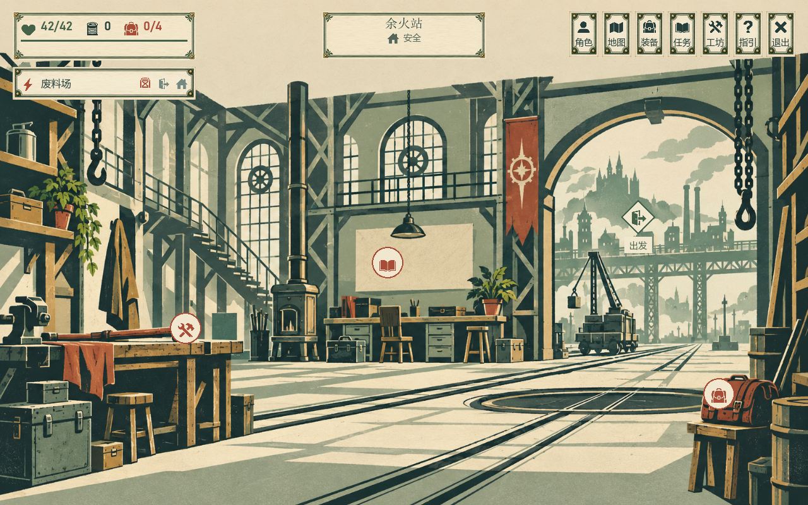

# CardRPG · 灰烬远征

装备决定卡组，行动推进区域，撤离保住收获。第一章已进入实现阶段，默认入口是可玩的**外环切片**：先把余火站的灯带回来，再发现维修偶、荧光暗室和无人列车。



HUD、按钮和七页操作面板现已接入生图制作的远征手册皮肤：象牙纸、墨绿边框、朱红主按钮与 24 枚透明图标；标题采用宋体风格，正文使用雅黑，HUD 数值使用独立数字字体。角色、装备、仓储、任务等页面重新划分内容区域，小窗口物品格位使用三列。[最新界面实机预览](doc/media/interface-preview.html) · [界面资源与完整生成词](game/Art/Print/Interface/README.md)。

画面采用木刻、剪纸与旧铁路海报的插画语言：暖纸色、墨绿、鼠尾草绿和少量砖红，保留清晰轮廓与大块明暗。场景、装备、敌人和任务物重新绘制；HUD 用图标、刻度与数字表达状态，圆形标记操作物件，菱形标记前往出口。装备图鉴直接展示供牌消耗和效果，工坊展示成品与材料，任务以实物卡片组织，路线图带有地点缩略图。完整说明在鼠标停留或键盘聚焦时展开。[新版界面与场景预览](doc/media/hud-preview.html) · [美术规范与生成词](game/Art/Print/README.md) · [初版像素风留档](doc/media/ui-preview.html)。

## 开始游玩

直接运行 **artifacts/Expedition/CardRPG-Expedition.exe**。复制游戏时保留整个 Expedition 目录，包括 .pck 和 data_CardRPG_windows_x86_64 文件夹。

从源码运行：双击 **Play-Demo.cmd**，它已启动第一章入口。需要 Godot 4.7.2 .NET、.NET SDK 10.0.401，Godot 路径由 GODOT4 环境变量提供。详细步骤见[编译、运行与导出](doc/10_技术实现/06_Demo编译运行与导出.md)。

## 怎么玩

1. 选择铁锤或短杖，去废料场拿封装继电器。战斗可以绕开，任务物到手后随时能回家。
2. 留意废铁里的敲击声，救出维修偶；也可去工坊关闭检修灯，发现荧光夹层。
3. 工坊启动台架后可换随身与新获得的装备；清障铲能横扫多个目标，但需要两点行动。
4. 回入口撤离，在据点交付继电器。灯亮后，屋内出现旧日投影。
5. 第二趟在广场取夹具，到工坊校准后带回；修好货站并交路签，可以改从货站出发。
6. 校准任务完成后开放手部、制作、改装与免费试用。若已把未校准夹具存仓，可在据点明确选择携带它再次出征。

鼠标可完成全部操作；Tab / Enter 操作按钮，C 角色全览、M 地图、I 装备、J 任务、F1 指引。Esc 返回上一级，从整备进入装备页后会先返回整备；顶层窗口关闭后回到场景。窗口内独立滚动，键盘焦点保留在当前窗口。文字保持原生尺寸，手牌和场景标签适应窗口宽度。阅读与比较装备不推进时间；每次有效操作自动保存。按 C 可总览生命、行动、魔法、护盾、负重、四个装备部位和完整卡组；战斗中显示本场实际牌组。按 I 点击部位查看可选装备与供牌，在“物品与仓库”格位页选中实物后取放，在工坊“背包与仓储”页制作背包与扩仓。首次无包只提供 4 格口袋，首趟可带回继电器、织物和废钢来制作拼布挎包。

战术撤退需承受本轮敌人意图，存活后退回进入位置，仍需自行撤离。敌人和牌区暂停保存，重返不会刷新开场。

## 当前范围

7 地点、8 装备、13 种牌、4 种敌人、2 主线、4 条完整支线及 S10 试用阶段；5 个战斗装备配方、3 个背包配方、U01 补给制作、3 次仓库扩建、2 改装方案、7 种材料、两种早期共鸣。背包总容量为 4／12／16／20 格，备用不限件数；负重超过 20 kg 时场景行动值翻倍。搜索与战斗奖励留在原位置，打开行囊选择拾取，同次远征可回取。

**水务、铸造、中枢区与五小时完整章节尚未实现。** 实际时长和数值乐趣需真人试玩，范围与阶段差异见[外环交付记录](doc/13_第一章_余火铸造区/08_外环实现与验收.md)。第一章使用 `chapter1-inventory-v2.json`，首次可迁移旧 `chapter1-outer-ring-v1.json` 并保留原文件；超容量旧物保留，整理后再出发。更早的 `expedition-v1.json` 仍独立保留。

## 开发与验证

```powershell
dotnet build CardRPG.sln --nologo --disable-build-servers
dotnet test tests/CardRPG.Core.Tests/CardRPG.Core.Tests.csproj --nologo
. ./scripts/common.ps1
Invoke-Godot -Arguments @('--headless', '--path', ('"' + $GameRoot + '"'), '--', '--verify-chapter')
powershell -NoProfile -ExecutionPolicy Bypass -File scripts/export.ps1
```

- src/CardRPG.Core/Chapter*.cs：章节规则、内容目录、任务与存档。
- game/Scenes/Chapter.tscn：默认游戏入口。
- game/Scripts/Chapter*：全屏绘景、物件交互、悬浮 HUD 与真实输入验证。
- game/Art/Print：12 张场景及状态图、3 张透明图集；覆盖 8 件装备、8 个角色与道具、8 件任务物及材料，附生成词与文件校验值。
- game/Scripts/ChapterIllustration.cs、ChapterSkin.cs：插画图鉴与纸张控件；细边线和文字由引擎原生绘制。
- game/Art/Generated：先前像素场景与界面切图留档。
- tests/CardRPG.Core.Tests：章节流程及旧原型回归。
- artifacts/Expedition：本机 Windows 导出包，不纳入 Git。

[第一章设计](doc/13_第一章_余火铸造区/01_章节总案.md) · [发现与惊喜](doc/13_第一章_余火铸造区/07_发现事件与前期惊喜.md) · [外环实现与验收](doc/13_第一章_余火铸造区/08_外环实现与验收.md)
