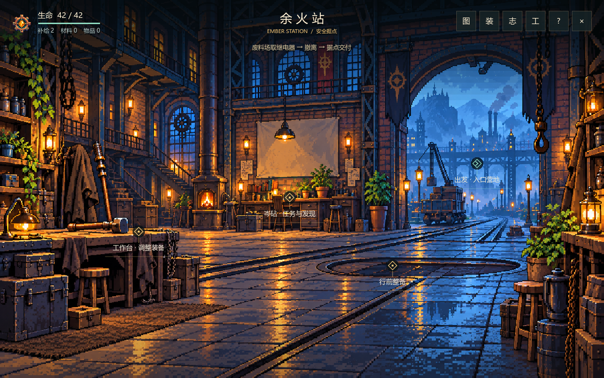

# CardRPG · 灰烬远征

装备决定卡组，行动推进区域，撤离保住收获。第一章已进入实现阶段，默认入口是可玩的**外环切片**：先把余火站的灯带回来，再发现维修偶、荧光暗室和无人列车。



画面采用卡通像素风全屏场景，点击物件和出口探索；M 打开只读地图，战斗角色、公开意图与手牌悬浮在场景上。装备、任务和整备按需居中展开。灯光、投影、维修偶和居民衣架随任务改变。[查看实际界面](doc/media/ui-preview.html) · [生图素材与提示词](game/Art/Generated/chapter/README.md)。

## 开始游玩

直接运行 **artifacts/Expedition/CardRPG-Expedition.exe**。复制游戏时保留整个 Expedition 目录，包括 .pck 和 data_CardRPG_windows_x86_64 文件夹。

从源码运行：双击 **Play-Demo.cmd**，它已启动第一章入口。需要 Godot 4.7.2 .NET、.NET SDK 10.0.401，Godot 路径由 GODOT4 环境变量提供。详细步骤见[编译、运行与导出](doc/10_技术实现/06_Demo编译运行与导出.md)。

## 怎么玩

1. 选择铁锤或短杖，去废料场拿封装继电器。战斗可以绕开，任务物到手后随时能回家。
2. 留意废铁里的敲击声，救出维修偶；也可去工坊关闭检修灯，发现荧光夹层。
3. 工坊启动台架后可换随身与新获得的装备；清障铲能横扫多个目标，但需要两点行动。
4. 回入口撤离，在据点交付继电器。灯亮后，屋内出现旧日投影。
5. 第二趟在广场取夹具，到工坊校准后带回；修好货站并交路签，可以改从货站出发。
6. 校准任务完成后开放手部、制作、改装与免费试用。若已把未校准夹具存仓，可在据点明确选择携带它再次出征。

鼠标可完成全部操作；Tab / Enter 操作按钮，M 地图、I 装备、J 任务、F1 指引、Esc 关闭面板。物品和任务详情支持滚动，手牌随数量与窗口宽度排布。阅读与比较装备不推进时间；每次有效操作自动保存。

战术撤退需承受本轮敌人意图，存活后退回进入位置，仍需自行撤离。敌人和牌区暂停保存，重返不会刷新开场。

## 当前范围

7 地点、8 装备、13 种牌、4 种敌人、2 主线、4 条完整支线及 S10 试用阶段；5 配方、2 改装方案、3 种材料、两种早期共鸣。包含巡逻预警、有限备用、永久修复、任务交付、战败恢复与完整存档。

**水务、铸造、中枢区与五小时完整章节尚未实现。** 实际时长和数值乐趣需真人试玩，范围与阶段差异见[外环交付记录](doc/13_第一章_余火铸造区/08_外环实现与验收.md)。第一章使用独立 `chapter1-outer-ring-v1.json`，旧 `expedition-v1.json` 保留，不自动迁移或覆盖。

## 开发与验证

```powershell
dotnet build CardRPG.sln --nologo --disable-build-servers
dotnet test tests/CardRPG.Core.Tests/CardRPG.Core.Tests.csproj --nologo
. ./scripts/common.ps1
Invoke-Godot -Arguments @('--headless', '--path', ('"' + $GameRoot + '"'), '--', '--verify-chapter')
powershell -NoProfile -ExecutionPolicy Bypass -File scripts/export.ps1
```

- src/CardRPG.Core/Chapter*.cs：章节规则、内容目录、任务与存档。
- game/Scenes/Chapter.tscn：默认游戏入口。
- game/Scripts/Chapter*：全屏绘景、物件交互、悬浮 HUD 与真实输入验证。
- game/Art/Generated/chapter：23 张已接入的像素素材及完整生成提示词。
- tests/CardRPG.Core.Tests：章节流程及旧原型回归。
- artifacts/Expedition：本机 Windows 导出包，不纳入 Git。

[第一章设计](doc/13_第一章_余火铸造区/01_章节总案.md) · [发现与惊喜](doc/13_第一章_余火铸造区/07_发现事件与前期惊喜.md) · [外环实现与验收](doc/13_第一章_余火铸造区/08_外环实现与验收.md)
