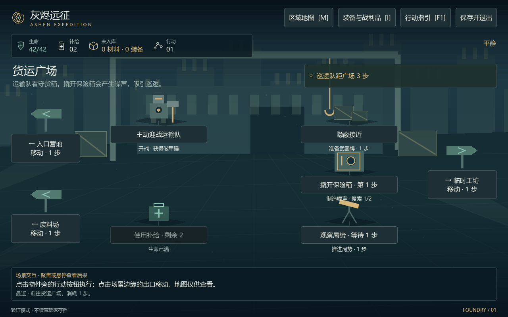

# CardRPG · 灰烬远征

装备决定卡组，行动推进区域，撤离保住收获。一个可玩的中文单人卡牌 RPG Demo：在废弃铸造区搜索装备、应对巡逻、改变挑战条件，带着战利品返回据点。



界面采用**单区域场景 + HUD**：行动页只显示当前区域，物件旁显示可执行行为，场景边缘显示相邻区域出口；按 M 打开只读地图，地图不提供移动操作。战斗使用悬浮敌人信息和底部手牌，装备与指引以覆盖层打开。[浏览全部界面](doc/media/ui-preview.html)。画面使用程序绘图；此前的[生图提示词与接入状态](game/Art/Generated/README.md)已保存。

## 开始游玩

直接运行 **artifacts/Expedition/CardRPG-Expedition.exe**。复制游戏时保留整个 Expedition 目录，包括 .pck 和 data_CardRPG_windows_x86_64 文件夹。

从源码运行：双击 **Play-Demo.cmd**。需要 Godot 4.7.2 .NET、.NET SDK 10.0.401，Godot 可执行文件路径由 GODOT4 环境变量提供。详细步骤见[编译、运行与导出](doc/10_技术实现/06_Demo编译运行与导出.md)。

## 怎么玩

1. 在据点选择铁锤或短杖，查看它们提供的卡牌，然后出征。
2. 点击当前场景边缘的出口前往相邻区域，每次消耗一步；M 查看地图，地图只读，阅读与思考不消耗时间。
3. 广场可主动挑战运输队，或撬保险箱。首步噪声会引来巡逻并预警；继续撬锁会被拦截，现在离开则可以脱离。
4. 战斗中点击敌人选择目标，再点击卡牌使用。每回合抽 5 张，结束回合弃掉剩余手牌。
5. 工坊可以换装和选择临时祝福；废料场可恢复货运站电源；切断熔炉警钟会移除首领支援。
6. 拿到装备后，回入口或已通电的货运站撤离。只有撤离才入库；战败丢失本次装备和材料，已有绑定装备与情报保留。

鼠标可完成全部操作；Tab 聚焦、Enter / Space 执行，M 查看地图，I 查看装备，F1 查看指引，Esc 关闭地图、说明或装备页。聚焦或悬停行动按钮会在底部显示完整后果。每次有效操作自动保存，退出后可继续进行中的战斗。

首轮可以只打运输队就撤离，下一轮再试工坊和首领。战术撤退需要承受本轮敌方攻击，存活后返回入口并损失最多 3 材料。

## 当前范围

一个固定六地点区域、五件装备、八种卡牌、三种临时祝福、巡逻预警与搜索中断、两种撤离位置、仓库收藏及完整存档。卡组完全来自装备，随机奖励和祝福不因读档重抽。

这是流程原型：属性加点、完整装备槽位、随机词缀、制作经济、背包负重和正式音效尚未实现。材料当前只累计。数值与内容规模待真人试玩调整。

## 开发与验证

```powershell
dotnet build CardRPG.sln --nologo --disable-build-servers
dotnet test tests/CardRPG.Core.Tests/CardRPG.Core.Tests.csproj --nologo
. ./scripts/common.ps1
Invoke-Godot -Arguments @('--headless', '--path', ('"' + $GameRoot + '"'), '--', '--verify-expedition')
powershell -NoProfile -ExecutionPolicy Bypass -File scripts/export.ps1
```

- src/CardRPG.Core：独立规则层、装备卡牌目录和完整远征状态。
- game/Scenes/Expedition.tscn：唯一入口。
- game/Scripts：Godot 界面、代码绘图与真实输入验证。
- tests/CardRPG.Core.Tests：规则、保存恢复与完整闭环测试。
- artifacts/Expedition：本机 Windows 导出包，不纳入 Git。

[设计文档](doc/00_游戏概览.md) · [第一章完整设计提案（尚未实现）](doc/13_第一章_余火铸造区/01_章节总案.md) · [接战规则](doc/06_世界与关卡/03_遭遇事件与交互节点.md) · [验收清单](doc/11_开发管理与验收/02_测试计划与验收清单.md)
