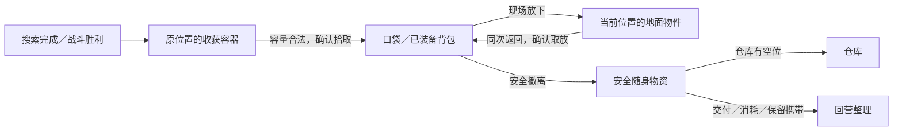

# 背包、仓库与局内遗留物

> 2026-10-13，玩法规则；背包、格位、遗留物、仓库与负重已接入外环。完整章节道具及高级消耗品仍为设计目标，差异见[实现记录](../13_第一章_余火铸造区/10_背包与负重实现.md)。容量与堆叠数为首轮试玩参数。[返回概览](../00_游戏概览.md) · [消耗品](03_消耗品与补给.md) · [材料、背包配方与仓库升级](../13_第一章_余火铸造区/09_携行制作与仓储扩充.md)

**玩家只能带走装得下的实物。穿戴占装备栏，其余随身物品占口袋或背包格位；回营后，未继续随身携带的物品占仓库格位。** 搜索与战胜敌人只揭示现场收获，不自动收入背包。留下来的装备、材料、消耗品和任务物在本次远征中保留原位，玩家可以腾出空间后沿原路返回取走。

这让出征准备、现场拾取和回营整理形成连续选择：多带备用和药品，会减少战利品空间；消耗药品会释放空间；大件新装备可能需要放下材料；更大的背包与仓库又需要材料投入。采用数量格位与负重双重约束，不增加旋转拼图或格子连通要求，避免整理操作盖过路线与构筑选择。

## 1. 生效范围与已有规则

当前外环以 `Stock` 实物实例为依据，装备、行囊、仓库和地点容器分别保存归属；原 `Owned/Loot/Backups`、材料数组和补给数字作为派生视图。已替换普通物品无限携带、无限仓库和独立补给上限，完整交付范围见[背包与负重实现](../13_第一章_余火铸造区/10_背包与负重实现.md)。

装备供牌、现场工坊换装、已登记装备战败保护、情报永久保存与任务物遗失后固定补取继续成立。背包新增为装备部位，但不供牌；卡组仍为 8／10／12 张。容量限制也适用于实体任务物，任务日志与配方知识不占格。

## 2. 装备栏、口袋、背包与仓库

| 容器 | 初始／上限 | 可放对象与规则 |
| --- | --- | --- |
| 装备栏 | 武器、身体、背包；手部／饰物按原任务开放 | 每部位一件；穿戴物只占对应装备栏，不再占储物格 |
| 口袋 | 固定 4 格 | 无背包时的全部携带容量；没有免费任务格或药品格 |
| 背包内部 | 仅已装备背包提供；首章 +8／+12／+16 格 | 与口袋组成 12／16／20 格随身容量，允许自动整理 |
| 仓库 | 初始 48 格，三次升级到 72／96／128 格 | 装备、材料、消耗品、任务物共用；同类筛选页不是额外容器 |

格位按物品占用量计算。例如一件占 2 格的武器只需总空位至少 2，不需要相邻空格；允许跨口袋与背包分配占用。未装备背包自身占 2 格，内部不可再装东西；仓库和背包里的背包均不提供额外容量。快捷栏、人台和收藏展示只保存物品引用，不能另存一份实物。

| 物品 | 每件／每堆占格 | 每堆上限 |
| --- | --- | --- |
| 武器、身体装备 | 2 | 1 |
| 手部、饰物装备 | 1 | 1 |
| 未装备背包 | 2 | 1 |
| M01～M05、M07～M10 材料 | 1 | 10 |
| M06 炉芯晶粒 | 1 | 5 |
| 消耗品 | 1 | 由[消耗品表](03_消耗品与补给.md)规定，通常 2，强效品 1 |
| T05 底座、T09 炉芯、T13 稳压装置 | 2 | 1 |
| 其余实体任务物 | 1 | 1；T08 两个来源分别占 1 格 |
| 可选笨重货箱 | 4 | 1，且同次最多携带一箱 |
| V09 运输包裹 | 1 | 1；保留原事件的交付条件 |

一堆 M01×10 占 1 格，M01×11 占 2 格。只有相同定义和可合并状态的物品能堆叠；材料的来源批次仍在堆内保存，避免首获结算重复。补给的借用品、免费出征份和永久实物不能合堆。校准状态、来源不同的任务物不可合并。

一次性或首获材料按种类与数量记账，不能继续用一个布尔值代表整包已领。例如 A03 首获 M01×4／M02×2，只带回废钢时仅结清这 4 份废钢，下一趟补足未结清的 M02×2；首获全部结清后才进入后续 M01×3 的常规产出。本趟尚在地面的余量不会再次生成，已在现场合法消耗的份额也记为已结清。不可用丢弃、合堆或部分领取反复刷首奖。

备用装备取消两件上限。未穿戴的战斗装备和背包只受随身格位限制，数量可以超过两件，同时计入负重；没有独立免费栏。工坊只能换用实际携带的物品，出发装备放到别处后也不能远程调用。出发前还需留出所选免费补给的格位。

### 负重与场景行动值

角色负重上限首轮定为 **20 kg**。穿戴装备、已装备背包自身、未穿戴装备、材料、任务物和补给都计入；仓库与地面物品不计入。等于上限仍正常，超过上限允许继续携带，但场景行动值乘 2。

倍率使用行动开始前的重量：移动、搜索、设施、使用补给、主动接战、巡逻中断和付费取放，普通 1→2，噪声搜索的合计 2→4。放下重物的这一步仍按原负重计算，下一步恢复正常；拾取后刚超重也从下一行动开始计罚。免费查看、整理、合法换装、首次搜索结果装包和撤离仍为 0。战斗行动点与牌费不翻倍，巡逻每次实际场景行动仍至多移动一次。

每件重量与堆叠分别配置；堆叠只减少占格，不减少总重量。例如当前铁锤 4 kg、铆钉护甲 6 kg、拼布挎包 1 kg，15 份废钢各 0.6 kg，总重恰好 20 kg；再加一份废钢即进入超重。UI 显示实际重量、上限、超重文字和操作的最终行动值。

## 3. 拾取、交换与返回收集

1. 搜索按原行动步数完成，或赢得战斗后，在该物件／战场生成一个有唯一编号的收获容器。先生成实物，再更新来源完成状态；击败敌人不代表已经拿到其装备。
2. 玩家免费查看内容、比较装备、选择数量和预览格位。首次搜索动作可包含一次装包确认；后续返回该容器的“取放”算 1 次区域行动、压力 +1、巡逻移动一次。一次确认可以包含多件取放，不按每件收费。
3. 确认时按交换后的最终布局验算。容量不足则整个方案不生效，指出差几格；“尽量拾取”必须先展示实际列表，由玩家确认，余物留在容器内。
4. 关闭拾取页、离开地点、战术撤退或读档都保留剩余物品。回访时原容器可再次打开，不重搜、不重战、不重新生成奖励；只支付本次取放的 1 步。

初次搜索生成后的免费装包机会仅属于紧接着的结果页；关闭结果页、执行其他区域行动或结束该次处理即失效，读档按保存状态恢复。战后首次拾取也有一次免费装包机会；整理口袋／背包内部不推进时间。

已经收到巡逻停留预警时，返回取放与其他区域行动一样先触发拦截，尚未确认的交换不执行。首次搜索被拦截也不会提前生成收获。战斗、敌人结算和共鸣选择期间不能丢弃或拾取地面物品。

主动放下物品时，在**当前位置**生成地面物件，而非传回掉落来源。与已有容器交换则放入该容器。地面物件记录地点、场景锚点和物品实例；离开再来仍在同一位置。无法再进入的区域必须在离开前提示遗留损失，主线路线不得无提示永久封死装有关键任务物的位置。

地图只标记玩家已发现的遗留点，显示剩余种类、任务物标记和大致占格。不得显示未搜容器内容，也不能通过地图远程拿取。

### 遗留物保留多久

本设计的“可返回收集”限定为**同一次远征**：跨地点、跨战斗、退出游戏再读档均保留；成功撤离、战败或明确放弃远征后，本次普通遗留物随区域重置。撤离确认列出遗留任务物与稀有装备，不逐件弹窗。

普通材料与消耗品按下一趟来源重新生成；尚未成功登记的首获装备、未完成任务所需实物按原规则补取。检查唯一性时同时查询穿戴、随身、仓库、当前地面容器、交付和永久安装记录。一个 T08 来源不能因物品被放到地面就再次生成。

## 4. 换装与更换背包

据点可以自由换装；局内继续限定在已启用工坊，战斗中禁止换装。穿上地面新装备也先经过该地点收获容器和同一次容量事务，不能隔着地图调用仓库或别处掉落。

穿上装备释放它的储物格，同时必须给卸下的旧装备安排位置。换大包同样要安排旧包的 2 格；换小包或卸包则按更换后的容量验算。空间不足时可在确认页选择将部分物品放在脚边；未明确选择前不自动丢物，也不先执行一半换装。涉及地面取放时按上一节付 1 步；纯内部重排及合法换装仍免费。

例如装备 +12 格背包时总容量 16，已用 13 格；换为随身的 +8 格背包后容量变成 12。新旧包各占 2 格互换，不额外释放空间，因此至少需放下 1 格内容。取消则装备、物品和容量全部保持原样。

背包容量不叠加，不随护甲改装增加；D08“应急工具袋”仍只是供牌改装，不提供实体容量。背包不占武器／身体位，也不增减卡牌数量。

## 5. 安全撤离、仓满和制作空间

成功撤离立即保住已经携带的物品，首次装备登记与来源标记只提交一次。系统将可合堆、可容纳的收获放入仓库，剩余物品保留在原随身容器；穿戴与玩家锁定携带的物品保持原位置。**仓满不会撤离失败，也不会自动销毁或变成无限待领列表。**

在基地可以从仓库或安全随身容器交付任务、使用材料制作、整理、回收或升级仓库。若暂不整理，可以带着合法装包再次出发；再次带出的材料、消耗品和任务物重新承担丢失风险。结算页必须单列“已带回但仍在身上”，不把这些物品称为仓库库存。

基地任务奖励先预览交付后的完整布局：计入任务物释放的格位、奖励生成和可合并数量。有空间才一次性完成交付与发奖；不足时保留任务物和未交付状态，允许整理后再交。没有可以累积的奖励邮箱。纯剧情情报不需要格位。S05 登记并退回 T09 使用同一个实例，不再生成一颗炉芯。

制作同样先验算“扣料后＋成品”的布局；材料齐全但产物无处存放时禁用确认。回收装备先移除原物，再检查产出的材料格；允许预览最终布局，不能自动将超额产物藏在工坊。仓库升级按扣料后的新容量提交。批量操作不能超量扣料或生成部分未报告的成品。

收藏图鉴、已学配方和已购改装不占格；可穿戴的装备实物必须有位置。回收已登记装备会失去该实物，但保留图鉴与工艺，之后可付原配方材料重制；仍持有该底材时不制造第二件永久副本。公共起始装备只在缺失时免费补领一件，同样检查容量，不能重复领出后回收获利。

重复战利品只有真正拾取并安全带回后才能按原表回收，不因“看见过”就获得材料。允许在回营整理时选择保留待回收或拆解；局内首版不开放随时拆装备压缩体积。

## 6. 战败与装备保护

| 对象 | 战败处理 |
| --- | --- |
| 仓库和留在基地的实物 | 保留，容量不变 |
| 已登记并合法带出的装备、背包 | 依既有保护规则恢复；不因穿过或放下而复制 |
| 本局新拾取装备、背包 | 丢失；穿戴不转为已登记 |
| 带入或局内取得的材料、消耗品、任务物 | 随身部分均丢失；材料不因来自仓库而获得保险 |
| 已使用的消耗品 | 不退还；免费基础份下一次按出征规则发放 |
| 永久修复、交付、情报和已购工艺 | 保留 |

出发时保存已登记装备的合法位置快照，并为其在基地的返还位置保留占位；这些占位不能重复用于存放其他实物。局内换上新背包后战败，按出发快照恢复旧包与受保护装备，普通货物已经丢失，不能把超量物品塞进 4 格口袋。成功撤离按实际回营布局结算。

返还占位使用仓库真实格位，按出发装备未穿戴时的体积计算，并在整备页单列“返还预留”；仓库可用格不足时先整理再出发。成功撤离时先把遗留的受保护装备放回预留位置，再释放未用占位并处理新收获；失败时先恢复出发穿戴／备用布局，再释放预留。占位只是承诺空间，不存在第二份装备，也不扩大 48／72／96／128 格上限。

本次放在地面的已登记出发装备也通过该快照收回，保持既有绑定保护；新战利品不适用。主动在基地确认回收／销毁是永久放弃实物，不能再利用战败恢复已销毁装备。丢弃任务物不等于销毁，同次可拾回，结束后按任务补取规则恢复来源。

## 7. 取舍示例与试玩目标

初始只用 4 格口袋：免费基础补给两份合占 1 格，T01 占 1 格，M07×2 占 1 格，M01×4 占 1 格。A03 同时揭示的 M02×2 留在原废机；玩家可放下废钢改拿导能线，或消耗／留下补给腾出一格。回营交 Q01 后，用带回织物与奖励废钢制作第一只背包。

装备 +8 格背包后，共 12 格。携带两件 2 格备用、两份补给 1 格、一个 2 格任务物，已用 7 格；再拾两堆材料和一件武器后占 11 格。新发现的 2 格身体装备需要放下至少 1 格物品，或者先去工坊穿上新装备并安置旧装备。只带一件备用的玩家则多出 2 格收益空间。

首轮观察目标是一次常规远征出现 1～3 次有意义的换物选择，已知路线回营整理尽量在 60～120 秒完成。它们是待测目标。若普通搜索每次都强迫整理，先调整掉落组合、堆叠和背包容量；若人人一律丢基础材料，则检查配方需求、单格价值和来源分布。不能靠每步弹窗或强制往返延长五小时章节。

## 8. 数据、迁移与实施顺序

| 新增数据需求 | 必须保存的约束 |
| --- | --- |
| 物品定义 | 占格、堆叠上限、类型、装备位、背包容量、使用与回收规则 |
| 实物实例／材料批次 | 唯一 ID、数量、来源、已登记身份、任务校准状态、免费份身份 |
| 容器与归属 | 装备、口袋、背包、仓库、地点容器；一个实例仅有一个位置 |
| 地面收获 | 远征 ID、地点与锚点、来源事务、剩余内容、初次装包机会是否用完 |
| 基地与返还 | 仓库等级、实际布局、出发装备快照、保留格位 |
| 消耗品使用 | 库存扣除、效果、行动费用、回合限次和任务来源结算同次保存 |

物品转移、换包、交付、制作与升级先在候选状态验算，再一次性提交容器、数量、任务标记与存档。落盘失败不提交候选状态，提示重试；重复确认使用同一事务标识，不能重复发物。现有界面会在保存失败时恢复本次操作前的完整状态，保留错误提示并允许重试。

内容与存档版本需升级，保留旧文件备份。旧 `Owned` 转成唯一装备实物与独立图鉴；穿戴从仓库清单扣除，`Backups` 转成实际携带，不能两处各造一件。旧 `Bank/Cargo` 按新堆叠拆分，任务物保留来源与校准；旧补给仅迁为当前远征基础份，不凭空变成永久药品。

迁移时不删除超容量历史资产，物品保留在原容器并标记“旧档待整理”。清理到合法容量前不能开启新远征，可在基地转移、制作、交付、扩仓或明确放弃普通物品。旧档在远征／战斗中可以先完成该趟，但取放不得增加已有超额占用；战败恢复旧配装仍超额时继续要求整理。普通新档不能超格装入。

实施依赖顺序：先做实例／容器与容量事务，再接拾取／地面持久化及换包，随后接基地仓库／交付／制作，最后接消耗品战斗指令与新内容投放。先在外环验证 4 格口袋、首只背包和第一次仓库扩建，再扩到后续分区；不能只增加容量数字而继续自动收取所有掉落。

## 9. 验收条件（外环已覆盖，后续章节待接入）

- 无背包只有 4 格；各部位穿戴不重复占格，备用、任务物和补给实物均占格。
- 材料 10→11 正确增加一格；部分拾取保存余量，拆分再合并不复制来源奖励。
- 满包搜索／战胜敌人仍留下完整物品；回访只进行取放，不重搜、不重发首获。
- 离开、读档、暂停战斗、跨区往返后，遗留物的位置、数量和实例一致；地图不能远程取物。
- 同次 T08 地面遗留阻止同源补发；结束后仅补足尚未持有或安装的数量。
- 换小包、卸包和地面换装按最终布局检查；取消／被拦截不丢物，不出现半套装备。
- 装备新包后战败恢复出发包与已登记装备；新包及带入消耗品丢失，没有负容量或幽灵物品。
- 仓满仍可安全撤离，余物留在合法随身格；再出发明确提示其风险，不生成无限邮箱。
- 交付／制作／回收检验扣除后的产物空间；仓满仍可交付能净释放格位的任务。
- 读档、连点和写盘失败不重复扣料或收获；迁移保留旧资产且超额兼容只发生一次。
- 用无背包、无仓库升级路线分别检查 Q01、两个 T08 分流和 T13 撤离：允许放下可选物，主线不要求稀有背包或随机材料。
