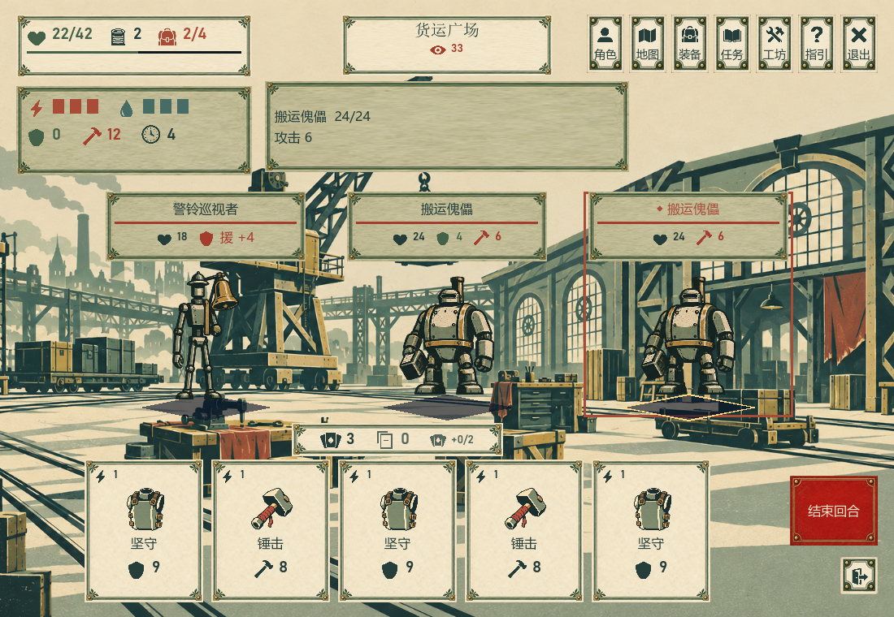
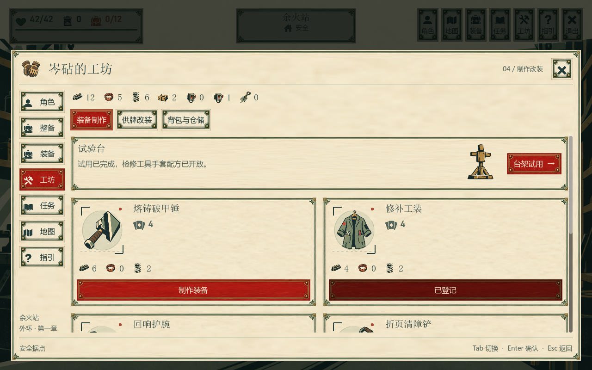
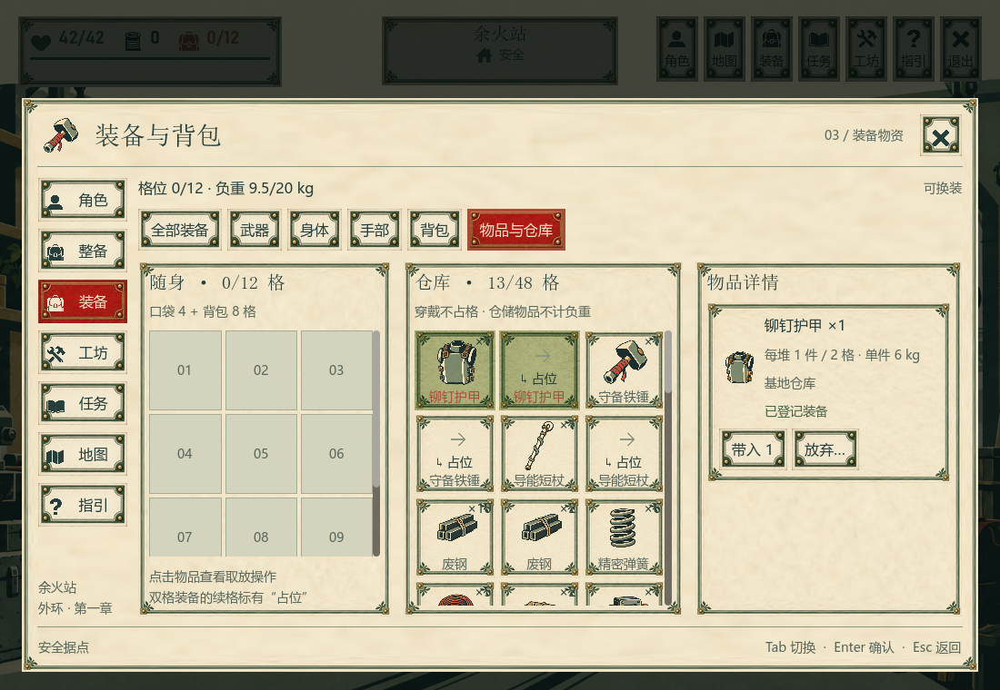
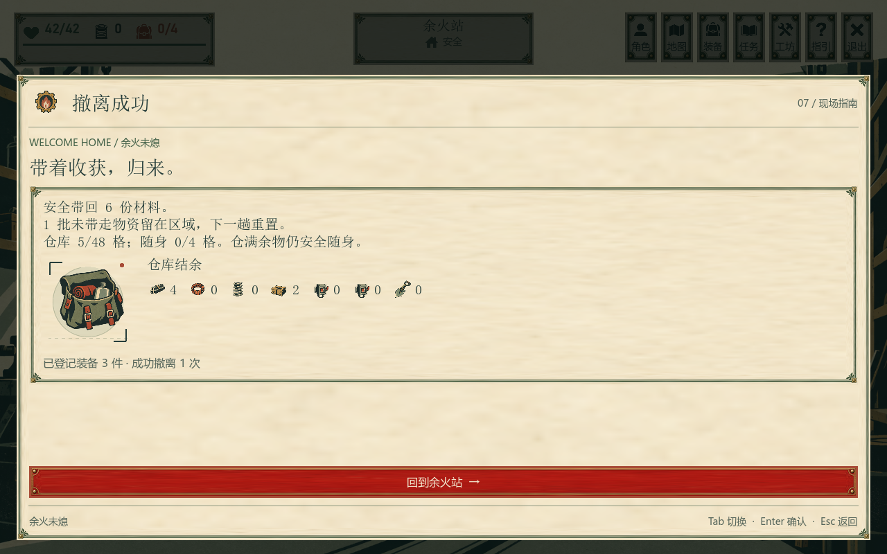
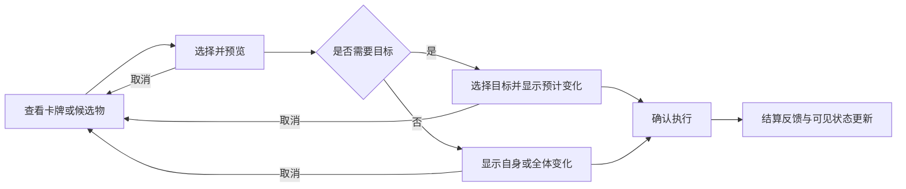

# UI、交互与视觉全面评审

> 2026-10-14 · 改造前源码基线 `6c1e05f` · 默认入口 `Chapter.tscn`。本文保留审查时的问题与建议；后续实现见 [22 组建议实施记录](04_UI重组实施与验收.md)。[现有界面说明](01_页面结构与导航.md) · [审查截图与验证记录](../media/ui-audit-20261014/README.md)

**结论：美术方向成立，基础操作链路完整，但决策信息、误操作防护和行动反馈尚未达到同类成熟游戏的水平。** 当前已经适合做外环玩法测试；若直接面向陌生玩家，仍容易出现“知道有按钮，却不知道点下去会发生什么”“装备看起来不同，却说不出构筑改变了什么”的问题。

建议保留木刻插画、暖纸色与墨绿、场景内交互点、按需展开的远征手册。下一轮优先投入 **战斗选择与预览 → 撤退及互斥选择的风险表达 → 装备、制作、改装对比 → 拾取和仓储效率**，随后补齐结算与反馈。大规模重画场景的收益低于改善这些操作。

## 1. 本次结论依据

实际执行了源码构建、第一章无头自动交互验证，以及隔离 Windows 桌面中的真实图形渲染验证。后台桌面未切换到用户桌面；输入通过 Godot 视口注入，截图读取渲染纹理。两个交互验证均输出 `CHAPTER_VERIFIED`、退出码 0；构建为 0 警告、0 错误。

共生成 **73 张实机截图**，覆盖 1100×760、1280×800、1600×900。全部做了缩略总览检查，关键页面另做原尺寸检查，并结合页面、控件与规则代码判断。保留 11 张关键原图、7 张联系表及截图尺寸与 SHA-256 清单。截图中部分页面经过键盘聚焦和滚动；例如整备页上方内容被滚出视口，不据此认定为布局溢出。

| 覆盖范围 | 本次方式与边界 |
| --- | --- |
| 据点、7 个地点、点灯／救援／暗室／货站变体 | 实际流程、截图、代码 |
| 七页手册：角色、整备、装备、工坊、任务、地图、指引 | 实际输入与截图，装备／制作／任务子页另检查 |
| 普通战、巡逻、三敌人、额外抽牌、不可用牌、试用 | 实际输入与截图；军需领班限时奖励界面仅代码检查 |
| 满包、超重、地面回取、备用、仓库、制作背包、扩仓 | 实际输入与截图 |
| 成功撤离、战败、回营、存档序列恢复 | 实际流程；验证模式不读写玩家存档 |
| 悬停／键盘说明、模态焦点、嵌套返回 | 现有自动验证；不能替代所有快捷键组合测试 |
| 丢弃确认框、真实保存失败、真实退出／重新启动恢复 | 代码检查；未在本轮实际触发 |
| 色觉、字号、DPI、读屏、手柄 | 做了选定截图的绿色盲近似模拟与名义色值对比度计算；其余未完成专项测试 |

审查对象是当前第一章外环。旧 `Expedition.tscn` 属历史回归入口；尚未实现的完整章节、局外建设扩展不按现有页面验收。没有进行竞品亲自操作测试，也没有测得玩家任务完成率、误点率或眼动数据。下文“容易误点”“阅读负担高”属于由画面和行为推导的设计风险，不是已经统计出的玩家行为。

## 2. 对照游戏：借鉴可用的交互原则

以下对照来自开发商／发行商页面中的官方截图与开发者演讲。截图仅说明当时的布局与表达方式，尤其《杀戮尖塔》素材含早期版本，不能当作当前版本完整交互规格。

| 参考对象 | 观察到的设计 | 对本项目的建议 |
| --- | --- | --- |
| [《杀戮尖塔》官方媒体包](https://www.megacrit.com/press-kits/slay-the-spire/) | 战斗截图将能量、手牌、敌方意图、结束回合分区；被查看的牌显著放大，效果文字仍在牌上 | 固定战斗阅读顺序，查看卡牌时在操作附近展开；保留明确费用和公开意图。无需照搬扇形手牌或奇幻装饰 |
| [《Griftlands》官方媒体](https://www.klei.com/games/griftlands) | 战斗图通过目标轮廓与指向关系解释行动；对话图把选项及后果说明放在同一区域 | 给卡牌与敌人建立可见联系；列车和共鸣选择集中展示代价与互斥关系。无需复制其多角色战场 |
| [《Backpack Hero》发行商截图](https://prettysoon.games/game/backpack-hero/) | 背包画面直接呈现物品所占空间，图鉴用类别帮助检索 | 让容量、物品形状和整理动作一眼对应。本项目是自动整理的容量系统，优先做清楚的跨格占位，空间拼图应另作玩法决策 |
| [《Into the Breach》开发复盘，第 14、31 页](https://media.gdcvault.com/gdc2019/presentations/Into%20the%20Breach%20Postmortem%20Final.pdf) | 开发者明确强调公开攻击、确定性，以及展示敌方目标和攻击类型 | 将公开意图进一步变成“本次出牌／结束回合后的预计结果”，把记忆和心算留给有意义的策略 |

可读性额外参考 [Game Accessibility Guidelines 的可调字号建议](https://gameaccessibilityguidelines.com/allow-the-font-size-to-be-adjusted/) 与 [W3C 文字对比度说明](https://www.w3.org/WAI/WCAG22/Understanding/contrast-minimum.html)。这里把它们作为设计检查基准，不将这次评审表述为游戏通过或未通过完整 WCAG 认证。

## 3. 值得保留的设计

1. **场景有明确辨识度。** 木刻轮廓、铁路工业题材和有限配色相容；点灯、维修偶、居民衣架等变化能让永久进展留在世界里。暗室与明亮外环也有清楚的明暗区分。
2. **探索画面以场景为主。** 按需打开手册避免长期遮挡；圆形物件、菱形出口提供了颜色以外的区别。普通按钮约 46 px 起、场景标记约 52 px，基础命中尺寸不小。
3. **阅读和思考免费。** 地图、角色、装备说明不推进区域压力；这很适合需要比较和规划的卡牌游戏。
4. **基本键盘能力已经存在。** Tab／Enter、C／M／I／J／F1、Esc 返回、模态焦点限制和嵌套返回均有实现。不可用手牌仍可聚焦查看原因，这是应保留的细节。
5. **装备与卡组的联系已有展示基础。** 角色页显示实际副本、来源和战斗中的真实牌组；装备页显示供牌，背包页区分携带与仓储。建议继续深化这一点。
6. **物品规则有保护。** 满包物品留原地、同趟可回取、永久丢弃前有确认、战败保留部分永久进展。这些规则降低挫败，UI 应把它们表达得更直接。

## 4. 全页面考核

“合理”表示主要结构适合当前目标；“需优化”表示存在影响理解或效率的缺口；“待专项验证”表示证据不足。它们是设计评审结论，不是玩家评分。

| 页面／维度 | 判断 | 最值得处理的内容 |
| --- | --- | --- |
| 据点 | 结构合理、初次引导需优化 | 任务人物和整备点默认少文字；新玩家容易直接出发，错过装备决定卡组的概念 |
| 全局 HUD | 状态基础合理、语义需优化 | 场景目标主要是地名和图标；压力只有数字时难以推断下一步风险 |
| 探索热点 | 空间关系合理、成本表达不足 | 关键与普通操作的命名、费用、战斗与非战斗性质过度依赖悬停 |
| 列车／共鸣 | 需优先优化 | 互斥选择表现成普通可拾取点；选完立即生效 |
| 地图 | 基础定位合理、规划能力不足 | 有路线、当前位置、撤离点；缺少任务目标、已搜／未搜、巡逻及路径成本的图内表达 |
| 战斗 | 基本可玩、决策与防误操作需优先优化 | 目标先选、牌立即打出；效果说明远离手牌；没有目标结果预览 |
| 试用 | 规则合理、入口与结束体验需优化 | 免费借装保护了资源；基础战斗教学却不能由此覆盖首次战斗 |
| 角色全览 | 结构合理、阅读效率需优化 | 有完整属性／装备／卡组，但大型卡片让全组概览需要滚动 |
| 整备 | 检查项基本完整、状态预览需优化 | 固定出发按钮好；容量数字和出征配发后的最终状态未集中呈现 |
| 装备 | 详情较完整、比较能力不足 | 显示所选装备，缺少与当前同部位装备的增减对照 |
| 行囊／仓库／遗留物 | 规则完整、效率需优先优化 | 续格重复、名称截断、按批次操作、多栏独立滚动；全拾取可能直到点击后才报容量不足 |
| 制作／改装／扩仓 | 需优先优化 | 制作缺少供牌效果；改装只有名称替换；阻塞原因不够具体 |
| 任务／发现／日志 | 分页合理、任务行动性不足 | 全部记录混合状态，详情默认折叠；日志与当前目标竞争空间 |
| 胜利拾取与成功结算 | 反馈不足 | 战斗结束直接进入物品管理；结算以仓库余额为主，未突出本趟净收获 |
| 失败结算 | 安抚语气合理、损失解释不足 | 说明损失类别，但没有本次逐项清单和下一步恢复建议 |
| 指引 | 参考资料合理、首次教学不足 | 有流程和图例；一次展示较多图标，仍要求玩家主动寻找和阅读 |
| 字体、对比度、状态编码 | 部分合理、存在可访问性风险 | 原生文字比位图文字清楚；14 px 密集正文、接近的状态颜色、无字号设置需处理 |
| 声音、动画、系统菜单 | 完成度不足 | 当前无音效及战斗过程演出；无专门设置／暂停界面 |
| 窗口适配、读屏、跨输入 | 基础尺寸已验证、专项未完成 | 三个桌面尺寸通过基础检查；760 px 最小高度、大字号、多屏 DPI、读屏与手柄仍需实测 |

## 5. 下一轮优先处理的 9 组问题

优先级：**P1** 为影响核心理解、选择或后果的项目，建议下一轮解决；**P2** 为随后改善效率与完成度；**P3** 为体验深化。严重度另分为“严重／警告／机会”。“严重”指后果或核心交互风险较高，并不表示已经出现崩溃。本轮已运行流程中未发现使主线无法继续的 P0 问题。

### U01 · P1／严重：卡牌选择与实际出牌没有明确分离

**事实：** 先点击敌人选择目标，再点击卡牌直接调用出牌。默认存在一个目标，目标死亡后自动换到存活敌人。查看卡牌依赖悬停／聚焦，未出现出牌前的连线、目标受伤预览或取消状态。连续出牌还会使手牌收拢，原位置换成另一张牌。见 [战斗代码](../../game/Scripts/ChapterGame.BattleUi.cs#L44)、[目标更新](../../game/Scripts/ChapterGame.cs#L63)。

**风险：** 新玩家可能将点牌理解为选择，或没有意识到仍沿用上次目标；快速点击可能打出位置变化后的另一张牌。现有“◆”与脚下标记能表达目标，但没有表达“这张牌将作用于谁”。

**建议：** 主交互改为“选牌 → 指向／选择目标 → 确认出牌”；Esc／右键取消，取消不耗资源。无目标牌可在选牌后再次确认；为熟练玩家提供快速施放选项。保留键盘等价路径，拖拽可后续增强。

卡牌聚焦时，目标身上预览“生命 24 → 16”“护盾 6 → 0，生命损失 2”等结果；全体攻击同时标记所有受影响敌人。预览应来自与结算一致的计算，覆盖穿盾、耗盾、回魔、共鸣和额外抽牌上限。**只查看不消耗行动，不暴露尚未公开的抽牌顺序。**

验收：取消操作前后状态完全相同；鼠标和键盘可明确更换目标；预览与 13 种现有卡牌的实际结算一致；牌位变化不把确认输入意外传给下一张牌。

### U02 · P1／严重：战术撤退和安全出口使用接近的表达

**事实：** 战斗右下角以无文字的出口图标触发 `EndTurn(true)`，点击即承受本轮敌方意图；代价与“仍需自行撤离”主要存在于说明面板。探索出口和免费结束试用也使用出口符号。见 [撤退按钮](../../game/Scripts/ChapterGame.BattleUi.cs#L23)、[实际结算](../../src/CardRPG.Core/ChapterSession.Battle.cs#L120)。

**建议：** 常显“战术撤退”，与“安全撤离”“结束试用”使用不同文字和危险标记。点击先显示紧凑确认区：退回地点、预计生命变化、敌人及牌区保留、仍未回营。预测会致死时写明“撤退后将进入紧急回收”，而非只换红色。

结束回合旁可常显“敌方攻击 12／预计失去生命 3”，让玩家在已有护盾下做判断。普通结束回合保持直接；仅首次或仍有可行动项时提供可关闭的提醒，避免每回合强制弹窗。

验收：确认前无状态变化；取消后继续当前回合；零伤害、可存活、预计致死及试用退出四种状态文案明确。

### U03 · P1／严重：互斥奖励和共鸣像普通探索拾取

**事实：** 列车出现三个分散标记，画面提示“三样东西，选之前可以比较”，但“本次只能先取一项”主要在此前说明和部分选项描述里。两个共鸣也是直接点击生效，其中“最多一种”没有在两项上等价常显。见 [探索规则](../../src/CardRPG.Core/ChapterSession.World.cs#L88)、[列车截图](../media/ui-audit-20261014/11-train-choices.png)。

**建议：** 发现时仍用场景标记；选项出现后打开一张轻量选择纸签，将三个结果并排呈现，常显“本次选择 1 项”。每项提供收益、用途、格位、重量、行动代价和未选项去向；选中只做预览，统一“确认选择”。共鸣沿用同一组件，说明持续到何时、是否可以替换。

列车应准确提示居民包裹的后续回取规则，避免制造永久错过支线的误解。空包空间不足时，明确说明物品先留原位，不能把“领取奖励”误写成“已经装包”。

验收：确认前可自由比较；确认后只生成选中结果；两种输入均能识别互斥关系，取消不推进区域压力。

### U04 · P1／警告：装备—制作—改装缺少连续的构筑对比

**事实：** 装备页能看当前穿戴和所选供牌，但没有“换上后增减什么”；制作配方展示图片、供牌张数和材料，不展示具体卡牌效果；改装以“锤击 → 盾刃”等名称替换呈现，效果与费用没有并排说明。见 [装备／工坊](../../game/Scripts/ChapterGame.Panels.cs#L88)。

**建议：** 复用一张构筑对比组件：当前同部位 → 候选，逐项显示移除／新增卡牌、副本数、费用、效果、重量变化与总卡组张数。背包对比改用容量、负重和当前物品是否容得下。制作页也应能在花材料前打开这张对比。

具体示例：从守备铁锤换为折页清障铲，应显示 **移除锤击 ×1（1 行动，8 单体伤害），加入横扫 ×1（2 行动，10 全体伤害）**，再列出重量变化。改装“锤击 → 盾刃”则并列 **8 伤害 → 6 伤害＋3 护盾**，说明只替换一个副本。这样能直接表达取舍，避免仅凭名字推断“升级一定更强”。

配方成本改成“废钢 4／需要 6”，只突出短缺项；成品占格不足单独提示。制作完成后提供“查看／穿戴”，并刷新对比。

验收：未持有物品也能查看效果；制作前可说明收益与代价；购买前后供牌数量及实际构筑一致。

### U05 · P1／警告：拾取和仓储让容量管理变成反复选中、滚动与点击

**事实：** 随身、仓库、详情三栏并列；双格装备拆成实物格和重复名称的“占位”格。物品常用 14 px 名称并截断，单件／整批操作在另一栏，批次相同物品又分开操作。满包时“全部拾取”仍可点，再由规则返回容量错误。见 [物品界面](../../game/Scripts/ChapterGame.InventoryUi.cs#L19)、[全部拾取规则](../../src/CardRPG.Core/ChapterSession.Inventory.cs#L191)。

**建议：** 保留并排容器，但把跨格装备画成一个连续占位块，名称、数量仅显示一次。空格缩减视觉重量。常显“格位／重量”两种约束，对当前物品提供取放后的预览。

根据空间将主操作写成“全部拾取”“可装入 X 件”或“空间不足”；部分拾取必须先列明会拿走／留下哪些物品及费用，不静默替玩家舍弃任务物。基地增加“存入本次材料”及可发现的快捷取放；区域内每次取放可能耗步数，不能把快捷操作做成不透明的连续消耗。

仓库扩展后采用紧凑列表／网格切换和材料、装备、任务物筛选。合并显示同类物品时仍保留免费配发、登记、校准等规则区别，减少批次信息对普通操作的干扰。

验收：选中后即可看见目的容器和结果；双格物不会被误读为两件；满包未取物清单准确；新增快捷取放与单件操作的成本一致。

### U06 · P1／警告：新玩家要先学习图例，才能理解第一趟应做什么

**事实：** 初始目标条主要为“废料场”及图标；多数普通热点只有悬停／聚焦后显示名称。出发点可以直接出征，初始武器选择和供牌理解藏在整备。F1 有完整说明，但需要主动打开。见 [HUD／据点](../../game/Scripts/ChapterGame.World.cs#L11)、[热点标题条件](../../game/Scripts/ChapterHotspot.cs#L36)。

**建议：** 首趟目标常显完整动词：“去废料场取继电器，回入口撤离”；取得后更新为“已装包，回入口撤离”。首次整备突出铁锤／短杖的玩法差别，并提示“首趟可不战斗”。首次战斗再讲意图、费用、选目标和结束回合，每次只讲当前需要的一件事，允许跳过和重新查看。

场景中的关键动作和危险动作常显短标签，例如“拿取继电器 · +1”“迎战傀儡”；普通物件可继续悬停展开。提供“显示全部标签”的可切换模式，兼顾熟练玩家看景需求。压力常显阶段和下一阈值；巡逻抵达时在相关操作附近补“继续操作会被拦截”。

验收：初次玩家无需打开长指引即可说明目标、最近撤离点和下一次行动代价；阅读仍免费，支线秘密不被教学提前剧透。

### U07 · P1／警告：战斗和获得奖励缺少可感知的过程

**事实：** `Change()` 更新规则后重建展示；现有 Chapter 代码的主要动画是通知淡出。出牌、敌方依次行动、伤害与护盾变化没有相应过程演出或声音。战斗结束后产生地面物品时直接打开库存。见 [状态刷新](../../game/Scripts/ChapterGame.cs#L55)、[通知](../../game/Scripts/ChapterGame.World.cs#L259)。

**建议：** 建立最小反馈链：牌离手 → 对应目标受击／护盾变化 → 数字短暂变化 → 进入弃牌堆。敌方按真实结算顺序显示意图执行，新援标明何时行动；胜利后先显示短结果与战利品，再进入取舍。重要获取使用实物名、图标和“在地面／已装包”状态。

预算建议为操作响应尽量在 100 ms 内，单次反馈约 120～250 ms；属于拟议目标，本次没有测得响应时延。提供快速／减少动态效果设置，避免每出一张牌都被长演出阻塞。声音先覆盖点击、选牌、命中、护盾、获得物品、危险六类，允许关闭，不能成为唯一反馈。

验收：观察画面即可解释本回合发生的生命、护盾、魔法变化；快速模式与正常模式规则一致；执行中不重复结算。

### U08 · P1／警告：结算没有突出“这一趟”的价值

**事实：** 成功页展示带回材料总份数、遗留批数、仓库余额、累计登记数和撤离次数；失败页说明损失类别。缺少本趟物品清单、任务推进、新增解锁及实际损失清单。见 [结算界面](../../game/Scripts/ChapterGame.World.cs#L270)、[结算数据](../../src/CardRPG.Core/ChapterSession.World.cs#L204)。

**建议：** 成功页按“带回物品 → 任务可交付 → 新装备／永久变化”展示增量，再提供仓库总量作为次级信息。失败页按“实际丢失 → 已保留 → 下趟恢复办法”展示，保留当前温和语气。

遗留物不能只报“1 批”，应显示地点和物品；对本次撤离会清除的重要遗留物，在离开前给出可返回查看的提醒。没有重要遗留物时不增加每次撤离的确认负担。回营后用任务徽记承接可交付项。

验收：结算能与出发前／回营后的物品变化对账；仓满仍随身的物品不被写成丢失；玩家能指出下一项可交付任务。

### U09 · P1／警告：原生字号与颜色系统仍有可读性风险

**事实：** 常规正文为 16 px，但卡组效果、供牌名称、物品名称等重要内容仍大量用 14 px；地图副标签为 12 px。没有字号设置，窗口最小高度 760。见 [字号函数](../../game/Scripts/ChapterGame.Ui.cs#L22)、[卡组文字](../../game/Scripts/ChapterGame.CharacterUi.cs#L106)、[地图文字](../../game/Scripts/ChapterRouteMap.cs#L60)。

按源码前景色与名义底色 `#e7dcc2` 计算：Ink 约 **8.53:1**，Muted **4.47:1**，Accent **4.11:1**，Danger **4.69:1**，Success **4.99:1**。这是平面色值检查；实际纸张纹理、变暗、选中状态的底色不同，不能据此宣称整页达标。常规文字可参考 4.5:1 目标，Muted 和 Accent 应进一步实测。[对比度基准](https://www.w3.org/WAI/WCAG22/Understanding/contrast-minimum.html)

绿色盲近似模拟中，圆／菱形和手牌锁图标仍可识别；普通红色动作与危险红色动作的色相区别价值很小，卡牌的细焦点边框也不够醒目。模拟是筛查辅助，不能代表每位玩家的实际视觉。[模拟检查图](../media/ui-audit-20261014/colour-check.png) · [所用模型论文](https://pubmed.ncbi.nlm.nih.gov/19834201/)

**建议：** 主阅读内容以 16～18 px 为起点，提供 100%／125%／150% 字号或 UI 缩放；大字号时重排面板，不能整体放大后裁切。细节需要低纹理底色。将品牌朱红、危险、当前选中、已装备、不可用拆成不同的语义角色，并用文字／图形冗余表达。焦点可加明暗双边框；不可用原因应在相邻位置可读。

验收：三种现有窗口尺寸及 1280×720 目标范围另行确认；在选定缩放下主信息完整可读；采样正常／悬停／选中／警告／禁用状态；读屏和手柄另作专项，不据当前 Tab 测试认定支持。

## 6. 第二优先级：减少摩擦并建立一致性

| 编号／级别 | 已确认的现状与影响 | 优化建议及验证重点 |
| --- | --- | --- |
| U10 · P2／警告 | 外框、栏框、物品框和按钮都使用较强装饰；多个标签、主按钮同为朱红，视觉权重接近。战斗背景与单位同样细密 | 保留外框及重点卡片的版画装饰，内层改用细线／留白；按区域建立主操作层级。战斗略压低背景对比度，强化单位轮廓，避免整幅场景统一变黑 |
| U11 · P2／警告 | 卡牌插图主要复用装备图：锤击／架盾猛击、坚守／稳固、预备工具／掩护射击区分依赖文字；部分材料复用任务物或装备插图。见 [图像映射](../../game/Scripts/ChapterGame.IllustratedUi.cs#L14)、[物品映射](../../game/Scripts/ChapterGame.InventoryUi.cs#L141) | 先补动作徽记、构图或姿态差异和材料短名，再按高频度补专用插画。锤、盾、抽牌、全体效果不以颜色独自区分 |
| U12 · P2／警告 | 战斗手牌在底部，完整说明在顶部；模态页说明带占用顶部较宽区域，连“返回场景”也占整条。探索说明与通知位于同一位置，可能覆盖通知 | 战斗采用靠近手牌的放大卡／侧边说明，避免遮敌方意图；简单按钮用短提示，复杂规则可固定阅读。通知与说明分别布局。见 [说明层定位](../../game/Scripts/ChapterGame.GraphicUi.cs#L41) |
| U13 · P2／警告 | 顶部七个菜单在所有主要阶段出现；战斗还能进入整备／工坊再看到限制说明。场景 Esc 无暂停，退出为一个直接保存并退出按钮 | 按阶段突出有意义入口，受限功能在入口旁说明；增加 Esc 系统菜单，集中继续、设置、操作说明、保存退出。退出不必无条件二次确认，但应与日常高频按钮分离 |
| U14 · P2／警告 | 嵌套窗口的返回历史只有页面名称；回到上页时优先聚焦关闭按钮，未恢复触发入口和该页滚动位置。多个说明对象也进入 Tab 序列 | 返回栈记录入口焦点与滚动；任务执行按钮优先，资料区可用方向键／区域导航查看。实际走“角色→装备→返回”“整备→仓储→返回”确认位置不丢失。见 [页面切换](../../game/Scripts/ChapterGame.cs#L69) |
| U15 · P2／机会 | 地图只读已有明确文字，因此“不能点击移动”本身不是缺陷；但路线图未集中表示任务、巡逻、搜索及遗留物，原型地点编号仍可见 | 优先加可选地点详情、当前目标及返回路径高亮，给键盘对应入口；如果后续加入寻路，逐步执行仍应保留途中事件和成本。隐藏无玩家意义的 A01 等编号。无需默认增加瞬移 |
| U16 · P2／警告 | 任务页默认全部记录，任务提示隐藏在问号内；可交付的数量主要在场景悬停中，完成页依旧占较多空间，日志只展示近期条目 | 默认“进行中／可交付”在前，当前目标常显下一步和地点，已完成折叠；任务入口加数量徽记。日志可按探索／战斗／物资筛选，重要解锁另作长期发现记录 |
| U17 · P2／警告 | 制作的禁用文案常为“材料或成品空间不足”，背包按钮可能仍写“制作背包”；已有物品也保持较重按钮样式。见 [制作状态](../../game/Scripts/ChapterGame.Panels.cs#L179)、[仓储制作](../../game/Scripts/ChapterGame.InventoryUi.cs#L151) | 显示具体短缺数、空间缺口或解锁任务；完成状态用“已制作／已登记”静态徽记。禁用对象保留独立可聚焦说明，不让键盘用户无法了解原因 |
| U18 · P2／警告 | 整备同时展示当前格位、出征补给、负重与出发地点；“当前格位”不是领取配发后的最终格位，初始未穿包又需要理解口袋规则 | 出发前固定一个最终状态摘要：“出发后携带 X/Y 格、Z/20 kg，已预留补给 N 格”；初次超重用文字解释行动代价，材料库存移为次级信息 |
| U19 · P2／警告 | 免费试用是检修手套教学，需完成 Q02；普通战斗可更早发生。试用完成仍以“结束回合”为最强按钮，退出只有图标 | 首次战斗另设短引导，保留现有专项试用；完成后把“结束试用并查看配方”设为主要下一步，不自动终止继续练习 |
| U20 · P2／警告 | 成功／失败结算右上角误显示“07 / 现场指南”；底部仍提示 Esc 返回，但基础结算 `_panel` 为空且关闭按钮隐藏，Esc 不负责回营 | 给结算独立页码／标题与“Enter 回营”提示；辅助文案按实际状态生成。见 [Overlay](../../game/Scripts/ChapterGame.Panels.cs#L26)、[Debrief](../../game/Scripts/ChapterGame.World.cs#L270) |
| U21 · P2／警告 | 现有说明文档仍写 canvas_items、最近邻采样、右上结束回合、上方通知；当前代码是 disabled stretch、场景／控件线性采样、右下结束回合、底部通知 | 确定新一轮 UI 规格后同步页面文档与验证脚本，防止按旧规则验收；实际布局以此次截图和代码为准 |
| U22 · P3／机会 | 世界状态变化有记忆点，但关键角色存在感与交付演出较弱；事件多以短通知收束 | 给岑砧和居民增加短对话／身份纸签；点灯、救援、交付的首次效果有可跳过短演出和回顾入口。优先少量关键时刻，避免所有搜索都弹对话 |

## 7. 建议的流程与实施顺序

先统一三类动作约定，再细化视觉。**查看**立即打开、免费且可返回；**执行**先把成本／结果放在附近；**不可逆或互斥选择**需要清楚的承诺时刻。普通移动、阅读、常规单件整理不应被一连串确认框拖慢。

这是拟议行为，不代表已实现。战斗、装备比较与事件选择可共享“查看—预览—确认”的表达；它们的真实资源成本和取消规则仍各自明确。

| 阶段 | 范围 | 完成标志 |
| --- | --- | --- |
| 第一轮：选择清楚、后果可见 | U01～U04；同时处理关键标签、禁用原因及文字对比度 | 无需翻指引就能理解目标和代价；装备变化与实际牌组对应；危险操作可以取消 |
| 第二轮：核心循环顺畅 | U05～U08、U12、U16、U18～U20 | 探索、拾取、撤离、交付、整备的下一步明确；本趟收获可核对；战斗因果可观察 |
| 第三轮：视觉与产品完成度 | 字号重排、U10～U15、U17、U21～U22，以及声音／设置 | 三种窗口与字体缩放专项通过；状态风格一致；输入与错误路径验证完成 |

不建议在第一轮同时引入背包空间拼图、地图自动旅行、复杂拖拽和全套新场景美术。它们会改变玩法或扩大验证面；当前问题大多可通过现有组件、布局和状态表达解决。

## 8. 下一次验收应补什么

现有自动验证擅长检查主线能否走通、按钮是否在视口内、控件是否重叠、存档序列和物品规则。它不能证明新玩家能理解图标、预测风险或比较构筑。建议保留现有验证并补以下专项：

| 验收任务 | 应观察的结果 |
| --- | --- |
| 首次进入据点并开始首趟 | 能说出任务、返回方式及是否必须战斗；无需外部讲解 |
| 普通战与三敌人战 | 能指出当前目标、牌将造成的变化，以及结束回合预计损血 |
| 低血撤退 | 在执行前理解会承伤、退回地点与尚未入库；可取消 |
| 列车三选一／共鸣二选一 | 确认前知道互斥及未选结果；取消不耗步数 |
| 铁锤换清障铲、锤击改盾刃 | 能准确解释卡牌增减和费用取舍 |
| 满口袋拾取、超重放下、仓库批量存入 | 知道会带走／留下什么、实际步数和操作后容量 |
| 撤离／战败 | 能区分本趟所得、仓库总量、实际丢失和永久保留 |
| 仅键盘与焦点组合 | Tab／方向键／Enter／Space／Esc 一致；特别检查手牌聚焦时 Space 是否与按钮激活冲突，此项本次未确认 |
| 大字号、低高度窗口、多屏 DPI、最长文本 | 文字不遮挡费用和主操作；焦点与说明可见；重排后仍能完成主流程 |
| 丢弃确认、取消确认、保存失败与重新启动 | 错误能读懂且可恢复；确认不误触底层；玩家存档使用隔离副本测试 |

可先邀请 5 名未接触项目的玩家做形成性测试，其中包含卡牌熟悉者与不熟悉者。记录是否完成、求助次数、误操作及玩家对后果的复述；这些才是后续验证优化收益的依据。可把“至少 4 人独立完成首趟目标、没有不知情的不可逆选择”作为初步迭代门槛，**它是建议目标，不是本次测得结果，也不是统计意义上的普适结论。**
