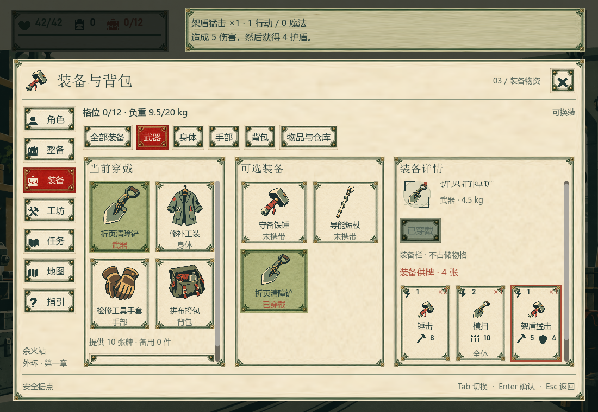
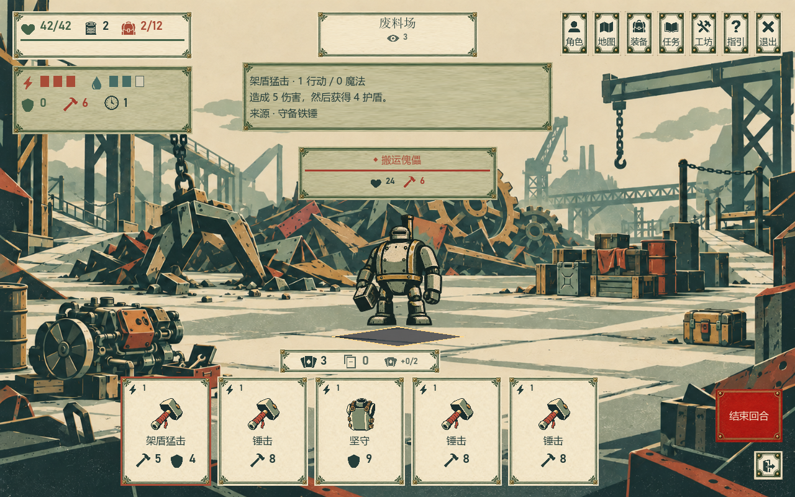

# UI 排版深度分析

> 2026-10-14 · 本篇保留改造前的源码与截图分析，讨论空间组织、信息层级、文字与组件尺寸。后续已启动实现，当前实现和验证以 [实施记录](04_UI重组实施与验收.md) 为准。

**核心判断：当前页面具备统一的外观，却过度共用了同一种空间结构。** 管理页面把资料、选择和执行分散在多个相近宽度的栏中；导航、标题、栏目边框和按钮又拥有相近的视觉重量。结果是主任务缺少足够大的连续区域，较少的信息被放得很松，真正需要阅读和比较的内容反而很小。

下一轮应优先明确每页的主任务，为它分配连续空间，再统一间距、字体和装饰。探索保留场景留白，战斗集中决策信息，管理页面按任务使用目录—详情、双容器或清单结构。

## 推荐的重组方向：统一视觉规范，采用五类任务布局

**建议保留“远征手册＋版画场景”的视觉身份，把页面重组为五类任务布局。** 统一标题、导航、文字、选中态和操作反馈；每类页面按玩家正在做的事分配空间。主要代价是维护几种布局模板，并分别验证窄窗口、长文本和滚动状态。这里保留决策时的方案，实施取舍见后续记录。

| 布局类型 | 适用页面 | 空间组织 | 首屏必须支持的判断 |
| --- | --- | --- | --- |
| 场景与路径 | 营地、探索、地图 | 状态和当前目标靠边，场景／路线占主体；交互标签靠近对应地点 | 我在哪里，下一步去哪里，哪里可以交互 |
| 战斗决策 | 战斗 | 敌人与意图保持关联；手牌、费用、牌堆集中下方；详情就近展开，回合操作固定右下 | 能出什么牌，对谁生效，结束回合会面对什么 |
| 目录与详情／比较 | 装备、制作、改装、任务、指引 | 左侧紧凑目录，右侧主要内容；比较时对齐字段，动作靠近所选对象 | 我选了什么，它有什么作用或变化，现在能否执行 |
| 双容器取放 | 随身与仓库、随身与地面 | 两个稳定的物品区，上方各自容量，下方所选物品与取放操作 | 从哪里移到哪里，移动多少，目标空间是否足够 |
| 总览与检查清单 | 角色、行前整备、成功／失败结算 | 关键摘要在上，明细在下；整备的目的地和最终状态紧邻出发按钮，结算的本趟变化紧邻下一步 | 当前构筑是什么，能否出发，或这一趟改变了什么 |

“同类模板”只复用区域关系。例如地图仍保留路线画布，角色总览无需确认按钮，结算也不需要复制整备的左右栏。目录页统一选择与阅读方式，但制作展示成本，任务展示下一步，装备展示变化。

### 优先定下的四个排版决定

1. **管理页拥有完整的阅读空间。** 手册上移，页头只保留标题、关闭入口与当前任务相关状态；正文从约 y=160 开始试排。探索 HUD 在场景中保持稳定，进入管理页后由紧凑页头承接必要信息。低频帮助入口可降级，页面导航的顺序和位置保持一致。
2. **高频判断占据连续主区域。** 装备页将四部位压缩为顶部摘要，下方采用“候选目录＋当前／候选比较”；物资页将分散的详情栏并入底部所选物品区，把宽度交给两个容器。长说明可以滚动，对象名称、关键代价与操作必须一起可见。
3. **装饰按层级分配。** 大页面保留纸张与角花；内部分组主要使用标题、间距和细线；卡牌、选中物品与主要动作获得清楚的轮廓。同一操作组只设一个主动作，分类和导航使用较轻的选中态。完整牌面用于读牌，紧凑条目用于找牌，物品格用于取放。
4. **窗口变化时重新分配内容。** 1100×760 优先保证完整规则与动作，可将装备比较压缩为当前摘要和差异列表；1280×800 作为主要试排尺寸；1600×900 用新增宽度显示比较字段和合理数量的条目。列数由容器实际宽度、单格可读尺寸与字号共同决定，长段落限制行宽。

### 推荐的第一轮落地范围

先完成**公共手册框架＋装备页＋物资页**。这三处能直接检验顶部空间能否回收、比较是否连贯、物品取放是否清楚。通过后复用到制作、改装、任务，再处理战斗的资源与读牌位置，最后整理角色、整备、结算与场景标签。

每类页面分别验收：装备的对象、关键差异和穿戴按钮同屏；物资的来源、去向和容量同屏；战斗读牌时敌方意图可见；整备点击出发前能看到目的地和最终状态；结算首先能辨认本趟获得与损失。布局重排与新增预测功能分开实施：例如预计承伤需要额外规则支持，不能仅靠移动现有控件完成。具体尺寸仍需按项目约定进行后台实机截图验证。

## 1. 尺寸证据：空间如何被分配

以下数据来自现有代码和上一轮实机截图。代码固定尺寸与截图近似测量分开标注；位置距离只是几何事实，不代表实际眼动或完成时间。

| 项目 | 当前事实 | 排版含义 |
| --- | --- | --- |
| 手册外框 | 固定从 y=108 开始，距左右各 24、底部 20 | 打开管理页后，仍为已经变暗、不可操作的场景 HUD 留出一条较高空间 |
| 装备页三栏主体 | 截图约从 y=290 开始，到 H−84；横向包络约为 W−194 | 标题、状态行、分类、导航和说明占用相当多空间，主体并没有覆盖整个手册 |
| 小供牌卡 | 紧凑模式最小尺寸 94×142，字号多为 14 | 栏宽增加时卡片仍保持紧凑尺寸，空白增加不等于信息更易读 |
| 角色完整牌面 | 每张最小高度 244，固定两列 | 总览容易变成逐张阅读；同屏较难看全不同卡牌的构成 |
| 库存格 | 高 88；窗口宽小于 1280 用三列，否则四列 | 列数由整窗阈值决定，没有保证所属容器中的单格最小阅读宽度 |
| 纸张装饰 | 九宫格纹理边缘为 18，部分内容内边距只有 4／6／12／14 | 装饰带与内容安全区并未使用同一套边界，窄卡文字尤其容易贴近角花 |

来源：[手册及装备结构](../../game/Scripts/ChapterGame.Panels.cs)、[供牌卡](../../game/Scripts/ChapterGame.IllustratedUi.cs)、[库存格](../../game/Scripts/ChapterGame.InventoryUi.cs)、[纸张皮肤](../../game/Scripts/ChapterSkin.cs)。

按上述截图边界估计，装备页三栏外包络的首屏分配如下。**这个包络包括边框、栏标题和内部空白，不能理解成有效文字面积；其余面积也并非全部浪费。**

| 窗口 | 三栏包络约宽×高 | 占整窗面积 | 说明 |
| --- | --- | --- | --- |
| 1100×760 | 906×386 | 41.8% | 低高度下，固定页头对正文的影响更大 |
| 1280×800 | 1086×426 | 45.2% | 主任务区不到一半画面，内部仍继续分成三栏 |
| 1600×900 | 1406×526 | 51.4% | 空间有所增加，但大部分组件没有按任务重新分配 |

### L01／警告：管理页的顶部预留没有充分服务当前任务

顶部保留少量生命、负重或场景状态是有用的，但目前还保留地点牌和菜单的背景形状，同时另有一条大面积说明框。玩家打开装备页时，需要优先看到装备和比较；“当前仍在余火站”不需要如此大的专属区域。

建议管理页外框提升到 y=24～32，将相关资源放入手册的紧凑标题行；说明放在对象附近或详情区。以 1280×800 为草案，标题、工具行合计控制在约 120～140 高，三栏改造后的主要内容可以从 y≈160 开始。若底部边界不变，可比当前增加约 130 高的阅读空间。**这是几何预算，最终要用真实字体和长文案确认，不能预先当作体验提升百分比。**

战斗和探索保持原有场景布局，不应跟随管理页一起改成占满屏幕的大表单。

## 2. 大小相近、边框相近，削弱了主次

### L02／警告：外框、栏目和条目都在争取注意力

装备页同时有手册外框、七个导航按钮、分类按钮、三个栏目外框、装备格、小卡片、操作按钮。这些对象大多使用相同的角花、双线边框和纸张底色。虽然风格统一，边框却没有清楚说明谁是页面、谁是分组、谁才是可操作对象。

建议采用三个层级：

1. **页面层：** 保留远征手册的纸张和版画外框，表达世界观与页面边界。
2. **分组层：** 用标题、留白或一条细线分隔；默认不再套完整装饰框。
3. **对象层：** 卡牌、选中物品、关键操作保留明确轮廓，让玩家知道真正可选择的对象。

同一区域只建立一个最强视觉落点。例如制作页应先看到所选成品及效果，再看到成本和制作按钮；当前分类选中、导航选中和所有配方按钮不必都用同样强的朱红底色。

这与视觉层级通过尺度、对比和分组引导阅读的原则一致；边框应在留白不足以表达分组时使用。[NN/g：Visual Hierarchy](https://www.nngroup.com/articles/visual-hierarchy-ux-definition/)

### L03／警告：三栏等高让无功能空白和拥挤同时存在

现有装备页中，当前穿戴只有四个固定部位，可选装备有时只有三件，但这两栏与详情一起撑到页面底部。详情里的供牌、说明却需要小字或滚动。1600 宽度时这种差异更加明显。

留白应当分隔关系、保护阅读或突出对象。固定少量内容被强行撑成大容器，而旁边的主内容仍然狭窄，属于空间分配问题。不能简单对所有区域同时“加留白”或“提高密度”。

## 3. 装备页：将“陈列三个区域”改为“完成一次比较”

### L04／警告：当前穿戴占据了过大的固定区域

当前结构是：左侧四部位穿戴 → 中间候选装备 → 右侧详情。这个结构适合浏览资料，但换装时真正要比较的是**当前同部位与候选物**。另外三个部位占据较大面积，却很少参与这一次判断。



建议结构：

- 顶部：武器／身体／手部／背包四个紧凑部位入口，保留名称和已装备缩略图。
- 左侧：候选装备目录，约 260～300 宽，使用行式条目或适度大小的图鉴格。
- 右侧：占主要宽度的对比区，当前与候选按同样的顺序排版。
- 对比区底部：固定的变化摘要与穿戴／备用操作；长说明在其上方滚动。

**对齐应围绕字段建立。** 两边的部位、重量、供牌数量、费用、效果从相同基线开始；共有卡牌低强调，变化卡牌位于对应行。只把两张不同高度的详情卡并排摆放，仍需要玩家自己寻找对应关系。

当前装备已经选中自身时，右侧可切回单物品详解，避免两边重复相同内容。比较另一件装备时再展示对照。

| 窗口宽度草案 | 目录 | 对比区策略 |
| --- | --- | --- |
| 1100 | 约 260 | 优先保证效果正文；当前装备可压缩为顶部摘要或差异清单 |
| 1280 | 约 280 | 当前／候选同时显示，费用、效果和变化摘要保持同屏 |
| 1600 | 约 300 | 增加完整规则和卡牌可读宽度；正文设最大行宽，避免无止境拉伸 |

这些是布局起点，不是已验证断点。实际阈值应由目录最小宽度、对比内容最小宽度、字号和间距共同决定。

### L05／警告：小卡片与大栏目不成比例

当前供牌卡固定约 94×142。三张牌加两个 8 间隔，只需要约 298 宽；1600 窗口的详情栏继续变宽时，卡片并没有利用新增空间增加完整描述。相对地，栏目里较大的物品图和标题更显眼。

建议使用同一份卡牌信息的三种排版密度：战斗牌突出费用、即时效果；比较牌突出副本差异与规则；图鉴牌允许完整阅读。保持费用、牌名、效果、来源的固定顺序，但不强行复用同一尺寸的卡壳。

验收重点：在当前默认窗口，看到候选后不需要滚动两个不同区域才能解释换装变化；扩大窗口后应增加能同时读到的有效信息。

## 4. 背包：让两个容器成为主体，详情承担辅助角色

### L06／警告：固定三分栏不符合容量差异

现在随身、仓库、详情各占约三分之一。仓库初始 48 格，后续达到 72／96／128；随身则常为 4／12／16／20。为它们分配接近的宽度，会让空行囊占较大空白，仓库持续滚动；详情里只有一个物品和少量操作时，剩余空间又没有承担比较任务。


建议中等窗口使用**双容器＋下方选中物品栏**：上方并列随身与仓库／地面物品，下方固定名称、数量、重量变化、取放动作。仓库获得更宽区域，但不要随物品数量实时改变两栏比例，否则取放时界面会跳动。根据“基地整理／现场拾取”选择稳定模板即可。

宽窗口可保留右侧详情，但先保证两个容器的最小可读宽度。详情至少提供足够的规则或比较内容，否则仍使用底部栏。空仓和空行囊显示简洁空态、容量总数及部分可见格位，避免一屏重色编号空格压过实物。

### L07／警告：1280 断点可能让窗口变宽、物品格变窄

截图中随身格在 1100 窗口三列时单格约 80 宽，在 1280 四列时约 75 宽。这里是像素近似测量，不是运行时控件矩形导出；但代码中的整窗阈值已能解释该现象。

建议列数依据**容器内可用宽度**计算，并以内容最小尺寸为约束：

```text
列数 = floor((容器可用宽度 + 格间距) / (单格最小宽度 + 格间距))
```

带文字的物品格可先以 96～112 宽为设计起点；若采用纯图标格，应另设明确的显示模式及固定可读详情，不能只把名称不断截短。窗口变宽时先增加格宽，到达阈值后再增列。跨两格的装备应采用连贯轮廓，名称和数量只出现一次。

保持网格稳定：滚动位置、选中物的可见性和键盘焦点应绑定实物身份，不能因增列、整理或移动到另一容器而丢失。

## 5. 战斗：围绕决策建立紧凑阅读区域

### L08／警告：手牌与详细说明的距离随窗口变高而增大

手牌从 H−194 到 H−18，中心 y=H−106；战斗说明框从 y=100 到 212，中心 y=156。因此两者中心的垂直间距为 H−262。

| 窗口高度 | 手牌与说明中心的垂直距离 |
| --- | --- |
| 760 | 498 px |
| 800 | 538 px |
| 900 | 638 px |

来源：[手牌位置](../../game/Scripts/ChapterGame.BattleUi.cs)、[说明框位置](../../game/Scripts/ChapterGame.GraphicUi.cs)。这不代表每次视线都走这么远，但说明当前布局把高频关联信息固定在了两个相隔很远的区域。



建议把阅读重心放在**手牌—费用—目标**之间：

- 行动、魔法和当前护盾靠近手牌左侧或上沿，费用能就近对应可用资源。
- 手牌说明采用就近展开的完整牌面，优先出现在选中牌上方或旁边，并限制高度，不能盖住敌方意图。
- 敌人保留自己的姓名、生命与意图组；意图字号／图形强度高于敌人名字，生命、护盾、攻击值位置固定。
- 结束回合与预计承伤聚为右下动作区，撤退与其留出明确间距和不同层级。
- 牌堆与弃牌数归入手牌区，避免成为中央悬空的小纸条。

现有手牌中心向左偏移，是为右侧按钮让位，属于可解释的布局选择；没有必要为了几何居中破坏它。真正需要处理的是分离的资源和远处的说明。

### L09／警告：背景、敌人、姓名板的层级关系偏弱

场景细节非常丰富，敌人又使用接近的配色。姓名板面积和边框有时比敌人主体更抢眼，选中敌人的变化主要是细线和小菱形。

可通过适度降低战斗区域背景细节／对比、统一敌人落脚线、增强轮廓与选中标记，把目光交给行动对象。单敌人和三敌人可以使用不同的舞台宽度；保持敌人信息板与其身体接近，不把它们当作独立悬浮面板。

这里的中央留白用于表现战场和目标关系，应保留。不要为了提高所谓占用率把整片战场填成数据面板。

## 6. 其他主要页面应采用各自的结构

| 页面／问题级别 | 排版问题 | 建议结构及第一眼应看到的内容 |
| --- | --- | --- |
| 角色全览 · L10／警告 | 属性、四件装备、完整卡组都占独立纵栏；244 高的牌面让“概览”变成局部图鉴 | 上方紧凑属性摘要；下方“穿戴摘要＋卡组构成”。默认紧凑牌表或较短卡片，完整牌面按需展开。第一眼是构筑特点、总牌数、费用和攻防组成 |
| 行前整备 · L11／警告 | 选武器、四部位大卡、背包插图和仓库材料占据首屏，出发地点在后续滚动区 | 左侧紧凑装备与随身清单，右侧固定“出发地点＋出发后最终状态”；出发按钮紧邻摘要。路线、预计容量、超重警告应首屏可见 |
| 制作 · L12／警告 | 试验台横幅占一整行，配方大卡重复按钮；默认窗口主要只能完整看到首行配方 | 左侧配方目录，右侧成品与效果，下方成本／产物空间／制作操作。试用变为适度入口；试用未完成时再给相关配方内提示 |
| 改装 · L13／警告 | 前后名称和插图散在宽行中，空间很大但缺少可比较的字段 | 使用同高的“原牌→新牌”对照，费用与效果对齐；成本和安装按钮在同一对照组内，避免跨整页寻找 |
| 任务 · L14／警告 | 任务详情默认折叠，而日志标题实际为 28，任务名字为 20；日志还有一张约 98 高场景图 | 左侧任务目录，右侧所选目标与步骤；日志放到独立标签或底部折叠。第一眼应看到下一步，而不是历史记录的装饰图 |
| 地图 · L15／机会 | 地名、缩略图、地点编号、图例竞争；节点与连线有时被分离阅读 | 优先突出当前点、目标和撤离路线，其次节点名称，缩略图作为辅助。可保留大面积地图留白；图例靠近图区边缘 |
| 指引 · L16／警告 | 大幅首趟流程图后接 16 项混合图例，具体规则从较低位置开始 | 先给“当前怎么操作”的三步短指南，图标按探索／战斗／物资分类；长规则进入章节目录，阅读栏限制行宽 |
| 成功／失败结算 · L17／警告 | 一大块左上文字、库存图标和底部全宽按钮之间缺少清晰内容序列 | 中等宽度居中的报告：结果标题→本趟变化→可交付或保留事项→下一步。清单决定面板高度，背景营地可适度露出 |
| 据点／探索 · L18／机会 | HUD 分散但基本符合看景需求；热点避让可能偏离物件，文字标签未完整参与碰撞约束 | 保留沉浸式画面；生命／目标左上合组，地点／压力合组，低频菜单收拢。热点标签显示时计入其完整矩形，位移后用短引线保持物件关联 |

整备截图已经出现滚动后的内容截断，这本身不等于布局错误；更值得修正的是**出发按钮常驻，而出发地点和一些检查项可能仍在卷动内容里**。应把必须共同判断的信息放在相邻且稳定的位置。

## 7. 字体、对齐、间距和装饰的具体规范

### L19／警告：字号有档位，但缺少稳定的文字角色

现有 `Text()` 将请求字号折算到 14／16／20／28：18 会变成 20，24 和 36 都会变成 28。字号达到 20 又统一切换标题字体。因此，代码表面上的“18 正文”“24 栏目名”“36 结果标题”并不能形成预想的层级。[字体实现](../../game/Scripts/ChapterGame.Ui.cs)

建议用角色命名替代数值猜测：

| 文字角色 | 默认尺寸草案 | 用法 |
| --- | --- | --- |
| 页面标题 | 28 | 一页一个主标题，使用宋体风格 |
| 分区／所选对象标题 | 20 | 数量受控，不让辅助日志大于当前任务 |
| 主要规则与效果 | 16～18 | 稳定的正文体，优先保证完整阅读 |
| 分类、数量和操作 | 16 | 清楚、可扫描，与图标基线对齐 |
| 来源、页码、次要说明 | 14 | 不承担重要费用、风险和卡牌效果 |
| 关键数字 | 根据位置 20～28 | 使用统一数字字体；只突出当前需要比较的数值 |

中文规则段落可先按约 24～36 个全角字符的行宽设计，行高以实机阅读确认，可从字号的约 1.4～1.6 倍试排。这是本项目的设计起点，并非所有中文游戏的通用标准。不要用固定额外 4 px 行距来假定已经达到同一种阅读节奏。

### L20／警告：对齐单位应从容器边框深入到内容基线

当前外框通常对齐，但物品名称、图标、数值、说明在不同卡片内可能分别居中或左对齐。对比时玩家仍要寻找字段。

建议文字说明、目录名称和字段标签左对齐；纯图标、小型徽记和单一数值可居中。相同字段的数值用固定列或右对齐；同一组数值保留小数与单位位置的一致性。图标按视觉中心对齐文字，不能只让外接矩形居中。

采用一条稳定的正文左轴。标题、分类、列表和操作组的文字起点尽量共用该轴；确需缩进的子内容用明确档位，避免每套卡框都增加一层微小且不同的缩进。

### L21／警告：现有间距更像逐控件调节，缺少关系语义

不必把所有间距机械改为 8 的倍数，但应让间距说明关系。建议起始规则如下：

| 关系 | 间距草案 |
| --- | --- |
| 图标与所属文字、数字与单位 | 4～8 |
| 同一对象的名称、费用、效果 | 8 |
| 同组条目、紧密排列卡片 | 8～12 |
| 并列内容区、操作与对应说明 | 16 |
| 独立分组 | 24 |
| 大区块或页面边缘 | 24～32 |

重点是组内间距小于组间间距。若两个不相关模块只隔 12，而同一对象的标题和效果隔了 60，用户会受到相反的分组暗示。

### L22／警告：纸张角花需要独立的内容安全区

当前装饰纹理边缘约 18，紧凑卡片内容间距却可能只有 6，个别文字距边 3～5。截图里的卡片费用、来源和长名称靠近角花，既影响阅读也削弱纸面质感。

主面板内距可保留 16～24；小卡如果必须紧凑，应换成简化边线和更小角花，不应继续把文字塞入装饰带。装饰纹理的绘制区域与文字安全区应分别定义；字体放大后优先增加卡片高度或换行，再减少装饰。

## 8. 滚动策略与响应式布局

### L23／警告：独立滚动解决了容器溢出，却增加了阅读位置的管理成本

装备页三栏分别滚动时，当前穿戴、候选和详情处在三个独立阅读位置。玩家可以滚动到一个状态：不知道当前操作按钮对应的是哪件物品，或者需要回头确认上方对象名。独立滚动不是一律错误，但应该只用于真正独立的长内容。

建议按模板限定：

- 目录—详情：目录独立滚动；详情长正文独立滚动，但对象名和当前动作固定。
- 双容器：两个物品容器可分别滚动；所选对象与目标容器持续可见。
- 整备：必要检查摘要固定，次要装备细节可滚动。
- 结算／指引：一个主要阅读滚动区，避免横向同时出现多根滚动条。

不要靠“按钮始终可见”就认定布局完成；按钮、对象和关键代价需要一起可见。

### L24／警告：响应式应改变结构，不只改变容器宽度

当前大窗口主要增加栏宽和空白，某些格位在阈值处反而缩小。新的排版至少需要同时考虑宽度和高度：

| 约束 | 布局行为 |
| --- | --- |
| 宽度受限 | 将固定穿戴摘要压缩，降低并列栏数；详细说明转为同区域展开 |
| 宽度充裕 | 优先完整显示比较字段、增加合理列数；长文设置最大行宽 |
| 高度受限 | 收起装饰横幅、页码和重复摘要，保持主操作与其对象同屏 |
| 大字号 | 按文本最小宽度重新计算列数，允许标签换行；重排而非整体缩小 |
| 空内容／少内容 | 使用紧凑空态，面板不因统一模板而强行占满 |
| 大量内容 | 分类与目录先解决检索，再考虑列表虚拟化；不要把大量空格排满首屏 |

先建立三种模板即可覆盖主要页面：**目录—详情**用于装备、制作、任务；**双容器**用于取放；**检查清单**用于整备和结算。探索与战斗保留专门模板。统一导航与字体，不要求内部栏目完全相同。

## 9. 实施顺序与排版验收

第一步调整手册外壳，回收顶部高度、减轻内层装饰、建立正文左轴。第二步重排装备和库存，它们最能检验新模板是否支持比较和取放。第三步集中战斗资源与卡牌说明，再调整制作、整备、任务和结算。最后才微调角花、纹理与动画。

| 验收方式 | 可观察标准 |
| --- | --- |
| 首屏检查 | 装备能看见当前对象、候选关键差异与操作；整备能看见出发地点与最终状态 |
| 宽度连续变化 | 不能仅因从 1279 增至 1280 就让物品名称明显更难读；结构切换后选中物仍可见 |
| 低高度检查 | 760 高下，装饰不能挤掉费用、规则和动作；720 高是否支持需另行确认 |
| 长短内容混排 | 最长物品名、最多卡牌效果、零库存及扩仓状态均可用，不依赖示例文本长度 |
| 视觉层级检查 | 模糊或缩略查看时，主要对象和主要动作先于装饰、历史日志与页码被识别 |
| 单色／色觉检查 | 分类、选中、焦点、可用／不可用的区别不只依赖朱红和墨绿 |
| 字号检查 | 正文字号提高后，内容重排；不裁掉卡牌费用、操作对象或危险说明 |
| 滚动检查 | 操作时名称、关键代价与动作同屏；返回后保留相应阅读位置 |

本轮复用了已验证的 73 张游戏截图并重新检查重点页面，未重新运行游戏，也未测量实际玩家眼动或效率。最小可读尺寸、模板断点与布局草案需要在真实 Godot 字体渲染下验证。本篇测量应作为重排依据，而不是用面积占比代替可用性测试。
