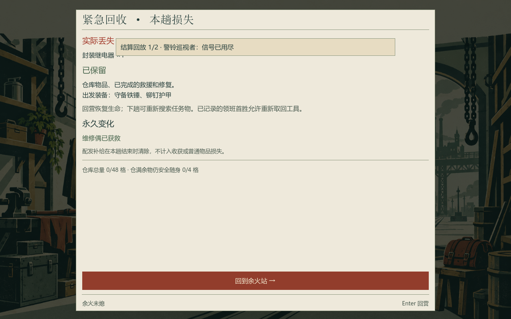
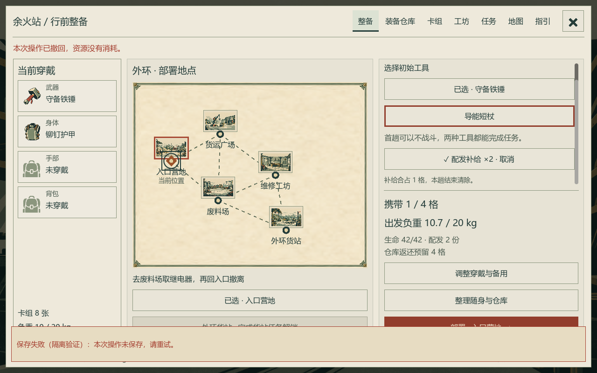
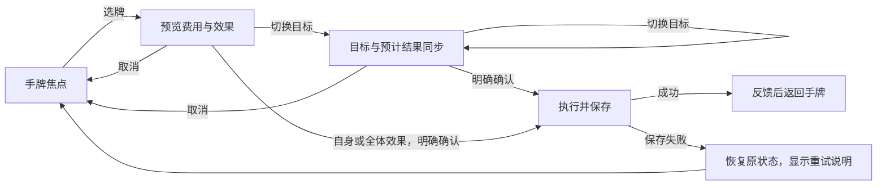

# 全界面深度复查与竞品对照

2026-10-15 · 受检版本 `cda7b29` · 第一章默认入口 `Chapter.tscn`。

**建议保留现有木刻美术与三栏仓储，下一轮集中改善“看见结果、理解对象、顺手执行”。** 当前的主要问题已经从首轮的空间不足，转向局部遮挡、展示与操作对象不一致、信息层级不充分，以及跨页面的理解成本。继续压缩页头或增加装饰，不能解决这些问题。

首轮整理 140 条方案，覆盖公共组件、7 个地点及当前各管理页、战斗、确认、奖励、结算和异常状态；随后追加 48 条操作便利性方案、16 条管理页方案，**累计 204 条**。完整条目见 [UI 优化方案清单](07_UI优化方案清单.md)，每条包含优先级、修改方向和验收条件；也可用[筛选看板](../media/ui-deep-audit-20261015/review.html)按界面、优先级和性质浏览。方案不是要求一次实现全部；新增的拖拽、手柄、配置预设等需要单独评估范围。

[便利性专项](07_UI优化方案清单.md#convenience)进一步对照《异星工厂》《泰拉瑞亚》《流放之路》《博德之门 3》《怪物猎人》的官方交互说明，分析批量整理、差量补给、材料规划、连续出牌、热点命中和误操作恢复。A141–A188 以源码复查与流程推演为依据，附新增功能的规则边界、统一输入约定和三轮实施顺序；没有增加真人耗时数据或扩大以下实机验证范围。

[管理页专项](08_管理页操作与信息密度专项.md)重新查看 8 张同版本原图，逐页分析操作往返、信息密度与可视化；新增 A189–A204，并提供[可切换密度和字号的布局示意](../media/ui-deep-audit-20261015/management-layouts.html)。该示意使用演示数据，属于设计评审材料，不是游戏改造实机或新的游戏测试结果。

## 1. 最先处理的十二项

| 顺序 | 当前证据与影响 | 推荐改变 | 清单编号 |
| --- | --- | --- | --- |
| 1 | 失败结算的“实际丢失”被战斗回放条覆盖，损失物名称被挡住 | 战斗回放只存在于所属战斗；转入结算时，最后一击结果成为结算内的一条摘要 | A127 |
| 2 | 保存失败横幅覆盖整备底部的部署按钮、负重和页脚；上方又有一条撤回说明 | 使用占据布局空间的错误区，合并说明并给明确重试入口；不覆盖当前动作 | A134 |
| 3 | S10 显示“试用已完成；剧场后续尚未开放”，下一步却仍要求完成试用 | 根据真实阶段输出唯一下一步；阶段完成且内容未开放时不继续派发不可完成的目标 | A113 |
| 4 | 同类物品合并后按堆叠画格，但每块都选中该组的第一个库存批次；底部另有批次切换 | 明确采用“同类物品总量＋数量选择”或“实际批次格”，保证图块、选中、数量、执行对象一致 | A078、A085 |
| 5 | 地图节点完全不接收鼠标输入，玩家必须改点右侧同名列表 | 节点和列表共享选择与焦点，只查看详情；移动仍通过场景出口，保持现有行动规则 | A043 |
| 6 | 整备地图把拟部署位置标成“当前位置”；玩家实际上还在余火站 | 分开“当前所在”“拟部署点”“选中查看”；部署按钮重复最终地点 | A029 |
| 7 | 选牌后中央出现 600×176 预览框，确认动作离开手牌；键盘选牌后没有明确的统一确认键 | 在手牌附近提供稳定的预览与确认区，建立“选牌—选目标—确认—返回手牌”键盘路径 | A050、A057 |
| 8 | 生命在左上，行动／魔法在左下，预计损血在右下，玩家需要跨屏计算生存结果 | 在战斗决策区显示“当前生命 → 结束回合后生命”，与护盾和结束回合相邻 | A051 |
| 9 | 大字号会放大正文，却不放大物品名、按钮、地图字和悬浮说明 | 将“阅读字号”和“整体 UI 大小”分开；阅读模式至少涵盖关键规则及其对象名称 | A015、A016 |
| 10 | 角色卡组只有少量卡种，却用全宽三行卡目与分隔线，首屏不能看全构成 | 默认紧凑卡表，按供牌来源／功能筛选；完整卡面按需展开 | A064 |
| 11 | 制作已成为目录＋详情，但改装、背包制作仍是连续全宽大卡和多个主按钮 | 改装使用单一装备上下文；背包、补给、扩仓分区，固定所选对象的成本和动作 | A099、A106 |
| 12 | 成功结算先重复带回物与净增加；故事弹窗留白很大，却缺少人物与变化的视觉证据 | 成功页先呈现本趟成果，历史清单折叠；关键叙事就近展示人物、物件与场景变化 | A128、A131 |

前两项是本轮明确的关键内容遮挡，列为 P0。其余按理解成本与高频程度排序，不把所有美观偏好标为严重缺陷。

## 2. 本次检查的依据与边界

开始时工作区无未提交变更。当前 53 项源码校验值、224 项导出文件校验值均与上一轮正式留档一致。本轮对同一导出包重新执行无头交互与未激活隔离桌面的实际渲染，两者均退出 0，并输出 `UI_REWORK_VERIFIED`、`CHAPTER_VERIFIED`。未启动前台窗口，验证模式跳过玩家存档和偏好文件的读写。

新生成 116 张截图，覆盖 1100×760、1280×800、1600×900；其中装备比较、仓储、整备、配方覆盖三档阅读字号。核对了上一轮同源码的 10 张全量总览，并对本轮 26 张重点原图逐张复核；**不是把 116 张新图全部逐像素复核，也不是所有界面都完成了九种尺寸／字号组合。** 截图、清单、校验值和日志见 [本轮证据](../media/ui-deep-audit-20261015/README.md)。

| 检查层级 | 覆盖内容 | 可以得出的结论 |
| --- | --- | --- |
| 当前实机图＋源码 | 据点、探索、整备、战斗、三敌人、额外抽牌、角色、装备比较、仓储、地面满包、制作、改装、背包制作、地图、任务、指引、选择、撤退、叙事、结算、保存失败 | 可以定位已出现的遮挡、信息层级和文字问题，并核对操作规则 |
| 交互回归＋源码 | 选牌／取消、危险确认、嵌套返回、Space 冲突、任务交付、存档回滚、完整外环 | 现有测试路径能完成，取消和预览受到保护 |
| 主要依靠源码 | 系统设置的全部选项、共鸣比较、部分拾取确认、日志／发现子页、旧档超容、极端空态／长文本 | 可以提出实现层面的风险和方案；未专门留存每种状态截图 |
| 尚未进行 | 陌生玩家观察、手柄专项、读屏、系统 DPI、多屏、色觉模拟、音效听感、连续窗口拖动 | 只能给出验证目标，不能声称已经可用或通过 |

旧 `ExpeditionDemo` 是保留原型，不混入当前第一章结论；尚未实现的主菜单、存档选择、完整章节区域作为新增机会讨论。标题中的“全界面”指当前默认游戏的界面清单，不宣称覆盖尚不存在的内容。

### 上一轮已解决的内容不再当作缺失

保留并继续使用：真实规则副本预览、显式出牌确认、撤退承伤说明、互斥选择比较、供牌增减比较、双容器与批量拾取、地面遗留、固定出发清单、已完成任务分类、结算持久化、阅读字号、减少动态、关键叙事回顾、嵌套焦点与滚动恢复。

例如“装备没有对比”“没有危险确认”“没有结算明细”“没有键盘支持”都已经不符合当前事实。本轮要解决的是对比是否紧凑、确认是否准确、明细是否优先、键盘路径是否自然。

## 3. 参考游戏：借鉴哪部分，为什么适合本作

参考资料于 2026-10-15 查阅。Steam 页面当前显示的英文评论口碑为：《杀戮尖塔》好评如潮、《陷阵之志》特别好评、《Hades》好评如潮、《Balatro》好评如潮。它们是本轮主要的热门好评参考；评价属于游戏整体，不能证明某个 UI 细节本身最优。来源分别为 [Slay the Spire](https://store.steampowered.com/app/646570/Slay_the_Spire/)、[Into the Breach](https://store.steampowered.com/app/590380/Into_the_Breach/)、[Hades](https://store.steampowered.com/app/1145360/Hades/)、[Balatro](https://store.steampowered.com/app/2379780/Balatro/)。

《Backpack Hero》当前英文整体特别好评、近期褒贬不一，因此仅作为背包交互的专项样本；《三角洲行动》作为搜打撤仓储组织样本，不据此给它贴整体口碑标签。[Backpack Hero 商店页](https://store.steampowered.com/app/1970580/Backpack_Hero/) · [三角洲行动官方教程](https://deltaforce.garena.com/en/news/system/RMDWVM)。

以下“迁移方向”是结合本作的设计判断，并非这些游戏的官方设计结论。

| 参考 | 来源中可核实的特点 | 对 CardRPG 的迁移方向 | 取舍 |
| --- | --- | --- | --- |
| 杀戮尖塔 | 官方商店战斗图把手牌、费用、牌堆、结束回合建立在稳定位置；构筑是主要玩法 | 固定战斗操作区；卡牌突出费用与动作；增加牌堆查看；少让确认按钮跨区跳动 | 本作由装备供牌，不增加自由删卡／加卡界面；保留预览安全性。[官方战斗图](https://shared.fastly.steamstatic.com/store_item_assets/steam/apps/646570/ss_01aa3e7759e457bfbf2422f31c325d7b3ba8a6eb.1920x1080.jpg) |
| 陷阵之志 | 官方说明明确所有敌方攻击提前公开 | 将“敌方意图→护盾抵挡→生命损失”作为统一阅读顺序；多敌人辅助行为也要说明对象 | 只预览当前规则公开的信息；随机抽牌不泄露具体顺序。[官方玩法说明](https://store.steampowered.com/app/590380/Into_the_Breach/) |
| Balatro | 官方原图中，目标、数值与局内资源集中；完整牌组页把分类统计与牌面同屏呈现 | 把构筑摘要和卡表放在同一上下文；关键数值的变化靠近来源；阅读顺序稳定 | 不照搬扑克叠牌造成的遮挡，也不引入高频闪烁、CRT 噪点。[官方截图包](https://www.playbalatro.com/press-kit) |
| Hades | 官方资料强调反复挑战和持续推进的故事 | 成功／失败回营都显示这趟的永久变化；关键居民与设施成为回营后的行动入口 | 保留本作安静的铁路手册气质；叙事可跳过、可回看。[官方资料](https://www.supergiantgames.com/games/hades/) |
| Backpack Hero | 官方介绍把背包组织本身作为核心玩法 | 借鉴格位占用、空间反馈和物品作用的直接呈现 | 当前本作位置不影响战斗，不应把“旋转拼图”作为默认优化；拖拽只先服务跨容器转移。[官方说明](https://thejaspel.itch.io/backpack-hero) |
| 三角洲行动 | 官方教程明确区分 Loadout 与 Storage，仓储示例把装备与物品并列 | 继续保留穿戴／随身／仓库，优化取放方向、数量、重量和结果定位 | 不套用枪械多部位、保险箱、价值颜色和售卖经济。[官方仓储示例](https://web.df.garena.com/03_news/news_banner/SMP/202602_NewToOperations/2.png) |

实质借鉴是让玩家在同一处完成一次判断。场景美术不需要变成这些游戏的样子；仓库、战斗、叙事也不需要强制使用同一种版式。

## 4. 分界面审查结论

| 界面与状态 | 当前值得保留 | 下一轮重点 | 方案范围 |
| --- | --- | --- | --- |
| 全局导航与返回 | 顶部统一导航、嵌套返回 | “角色／卡组”命名一致，X 与系统菜单分开，页面选择／焦点／危险三种状态分开 | A001–A021 |
| 余火站：初始、点灯、维修偶、居民回归 | 场景承担营地身份，设施在空间中可见 | 降低重复入口，突出可交付／可制作的新变化，明确首次出发主入口 | A022–A028 |
| 行前整备 | 穿戴、部署点与最终清单同屏 | 工具对比前置、容量盈余与目标需求、免费补给的来源与到期 | A029–A035 |
| 入口营地／废料场／广场 | 物件、出口已有形状区别 | “压力增加”与“获得物品”语义分开，巡逻预警与安全离开联动，空包到满包的教学 | A036–A042 |
| 工坊／货站／夹层／列车 | 灯、线路、夹层及居民物品已有状态变化 | 热点位置稳定、已用设施留轻量状态、避免每次发现都切出场景 | A036–A042、A120–A126 |
| 路线地图／部署地图 | 已揭示图、出口路线、遗留信息 | 节点直接选择、来源状态区分、目标／巡逻／遗留的地图图层 | A043–A049 |
| 普通战斗／三敌人／领班 | 意图常显、手牌可阅读、真实预览 | 生命与预计结果聚合、卡牌确认就近、敌人编号、全体目标高亮 | A050–A063 |
| 试用 | 隔离真实资源，完成后可去配方 | 用明确练习任务演示组合，完成状态与任务／配方同步 | A063、A113 |
| 角色与牌组 | 当前构筑、供牌来源与战斗牌组已区分 | 紧凑卡表、费用组成、牌堆、改装和共鸣来源说明 | A064–A070 |
| 装备比较 | 加入／移除副本已真实计算 | 同行对照与总构筑影响、已穿戴和候选视觉明确、条件失败具体化 | A071–A077 |
| 随身／仓库／地面 | 三栏、真实占格、整批与单件 | 展示单位一致、数量选择、容量后果、快速取放、位置保持 | A078–A091 |
| 装备制作 | 目录、成品、成本和操作同屏 | 材料用途与追踪、缺料导航、成品目的地、制作后直接穿戴 | A092–A098 |
| 供牌改装 | 前后规则、免费切回已实现 | 单装备工作区、只替换一副本的图示、损失与收益对齐 | A099–A105 |
| 背包／补给／仓库扩建 | 有真实条件与材料不足原因 | 三种任务分区、总容量对比、下一等级预览、购买后动作 | A106–A112 |
| 任务／日志／发现 | 进行中优先、可交付排序、回顾入口 | 阶段一致、目标追踪、定位地点、事件结构化、完成反馈 | A113–A119 |
| 战利品／列车／共鸣／部分拾取 | 明确物品仍在地面，选择与确认分开 | 缩短拾取链、三方案并列比较、保留“留在地面”结果、确认对象写入按钮 | A120–A126 |
| 成功／失败／叙事 | 净增加、实际损失与永久变化都已记录 | 层级不串页、成果前置、结算下一步和人物变化 | A127–A133 |
| 设置／保存失败／启动与恢复 | 已有字号、动态、音效、回滚 | 错误不挡操作、设置分组、键位说明与声音控制；启动恢复入口作为后续新增 | A134–A140 |

## 5. 五个建议定稿的交互结构

### 5.1 战斗：让“预计结果”跟随对象

上方保持敌人和公开意图；下方保持卡牌、费用、当前生命／护盾及回合操作。选牌只改变预览，不改变存档或随机数。目标头顶显示生命／护盾的预计变化，底部只展示简短结果与确认；完整规则可以展开。

推荐默认仍保留确认。熟练模式可提供拖向合法目标后释放出牌，但应先做原型和误操作观察；释放到空白处、Esc、右键都取消。单目标攻击的默认路径是“选牌→确认”两次点击，换目标时才增加一次，不能把当前所有牌都描述为四次点击。

键盘明确使用选牌键、方向键选目标、Enter 确认、Esc 取消、Space 结束回合。必须处理事件优先级，避免同一 Enter 同时选牌和确认。资源不足牌可聚焦查看原因。全体牌对全部有效对象做一致强调，自身牌不诱导选择敌人。

当前自动化的 `Click(..., completeFlow: true)` 会自动补按确认按钮，因此现有通过结果能证明链路执行，不能证明陌生玩家能发现确认入口，也不能证明自然键盘路径足够短。

保存失败后的“重试”应重新校验并执行玩家刚才确认的操作；如果状态已经回滚，不能仅保存回滚后的状态就提示该操作成功。切换上下文后应撤销旧重试动作，避免执行过期对象。

### 5.2 库存：先确定操作单位，再增加快捷方式

推荐默认使用“同类物品聚合项＋明确数量”，图上可以展示真实占格，但选择对象应是总量一致的物品组。若保留多格分堆展示，点击 ×2 的尾堆就必须默认选择 2 件，不能悄悄指向第一批；配发、校准、登记状态不同的物品仍分组。

下方操作区固定显示：**物品与来源 → 本次数量 → 目的地 → 操作后格位／重量／推进步数 → 执行**。单件和整批要分别给出准确后果，满包时显示需要腾出的格数。库存重建后保留选中对象、滚动位置，并在目的容器短暂标记到账物品。

| 备选 | 收益 | 成本与限制 | 建议 |
| --- | --- | --- | --- |
| 点击选择＋数量控制＋目的地按钮 | 清楚、支持键盘，与现规则一致 | 连续操作仍需两步 | 先完成，作为所有模式的可靠基础 |
| Shift 点击快速转移，拖到容器投放 | 熟练玩家省操作 | 必须有失效反馈、容量预览及键盘等价操作；野外会推进时间 | 第二阶段；野外不可把多次付费取放伪装成免费整理 |
| 自由摆格、旋转与空间拼图 | 增加背包整理玩法 | 涉及存档布局与规则，现有物品摆放并无战斗意义 | 暂不作为 UI 修复；只有玩法需要时再立项 |

### 5.3 整备：把“这一趟准备做什么”放到地图旁

保留当前三栏。左栏为穿戴与构筑摘要，中栏为部署点和被追踪目标，右栏为实际带入物、预计空余格、最终重量与出发动作。初始工具选择应能在原地看见供牌和费用差别，不要求新玩家跳去装备页才能知道铁锤与短杖的区别。

已知任务物的携带要求可以提示；尚未发现的奖励不提前剧透。显示“预计尚余 3 格”比只显示“携带 1/4 格”更直接。免费补给与普通补给用来源标签区分，避免“已配发”被误认为会永久入库。

### 5.4 工坊：统一成本、产物与操作的阅读顺序

装备制作、供牌改装、背包扩容共享：**目录 → 当前状态／候选差异 → 材料与产物空间 → 动作**。不必共享完全相同的字段。改装重点是替换哪个副本，背包重点是总容量与自重，扩仓重点是新旧仓库格数和解锁条件。

推荐把已拥有物品从“红色缺料＋禁用制作”切换到“已拥有＋管理装备”，避免用已经花掉的材料制造仍需补齐的错觉。缺材料时列清短缺数量与已发现来源；“追踪材料”只做界面标记，不自动替玩家购买或改变任务。

### 5.5 回营：成果、损失与下一步形成闭环

成功页先显示新带回的关键物品、新登记装备和永久变化，再给“回营交付／管理装备”；完整带回清单作为展开项。失败页先把损失和保留并排放好，明确失败原因与可继续推进的目标。两页都不残留战斗浮层。

故事页使用人物身份、关键物件与简短文字形成视觉中心。点灯、维修偶入站、货站修复等已有世界变化应被看到；不新增冗长强制过场。结算必须完成回营状态转换后再导航到任务或仓库，避免在结算阶段直接调用仅营地允许的操作。

## 6. 排版与可读性规格草案

这些是下一轮的设计起点，不是本轮已完成的改造，也不是固定行业标准。

| 对象 | 建议规格 | 验证方式 |
| --- | --- | --- |
| 文字角色 | 页标题 28、分区 20、主要正文／按钮 16–18、辅助来源 14；核心风险不放在 14 档 | 每页控制角色种类；选中对象名不小于正在解释它的正文 |
| 大字模式 | 主要规则、数量、对象名、关键操作一起增大；导航可采用独立 UI 缩放 | 1100×760 大字时仍看到名称、后果和操作，不只验证容器在屏幕内 |
| 中文规则段落 | 优先 24–36 个汉字的阅读行宽；窄卡允许更短，减少孤立单位／标点 | 检查“20 kg”、费用、百分比、最长物品名及括号换行 |
| 触达区域 | 继续保留当前约 40–46 高的按钮；图标触达区域大于图形自身 | 不以缩小点击范围换取更多内容 |
| 空间分组 | 对象内部 4–8，同组条目 8–12，栏目 16，独立区块 24 | 用间距和底色区分组，不为每段内容再画边框 |
| 状态表达 | 焦点用外框，选中用勾选／底边，危险用警告图标＋明确后果 | 灰度条件下仍区分焦点、选中、禁用、危险 |
| 主动作 | 当前对象通常一个主要动作；取消、查看、返回保持次级 | 不能一屏多个全宽朱红按钮同时争取注意 |
| 说明层 | 近对象展开；长说明可固定阅读；不覆盖执行对象与关键结果 | 检查悬浮、键盘焦点、滚动、切页后的生命周期 |
| 动效 | 小反馈以约 120–220 ms 起步；长事件结果保持到可读，再允许快速继续 | 实测输入延迟与阅读速度；减少动态不跳过必要结果 |
| 高分辨率 | 控制阅读栏最大宽度，增加有效比较内容；不把正文拉到全宽 | 1600 窗口避免“大空白＋小字＋长横线”的稀薄感 |

对比度参考 [W3C 文字对比说明](https://www.w3.org/WAI/WCAG22/Understanding/contrast-minimum.html)与[非文字对比说明](https://www.w3.org/WAI/WCAG22/Understanding/non-text-contrast.html)：普通文字以 4.5:1、承载辨识信息的控件图形以 3:1 为检查目标。禁用控件、纯装饰边线的适用条件不同，不把每一条浅分隔线都报为缺陷。游戏仍需做实际画面与设备检查，不能仅凭色值宣布整体无障碍合格。

## 7. 实施次序与验收

| 批次 | 内容 | 依赖／代价 | 完成标志 |
| --- | --- | --- | --- |
| 第一批：消除明确误导 | A127 回放串层、A134 错误覆盖、A113 任务阶段、A029 部署状态、A078 物品选择语义 | 局部表现修正；物品模型选定后再做快捷操作 | 对应原图问题消失，原有预览／取消／回滚仍通过 |
| 第二批：三个高频动作 | 战斗确认和结果、库存数量与取放、地图直接选择 | 输入状态机、数量预览与地图焦点共用基础 | 陌生玩家能独立完成出牌、取指定数量、查看地点 |
| 第三批：构筑工作区 | 角色卡表、装备差异、制作、改装、背包与扩仓 | 复用卡牌说明、成本、选中对象组件 | 无需反复切页就能解释一次换装的代价和收益 |
| 第四批：回营与阅读 | 结算、关键叙事、任务追踪、指引、字号与设置 | 状态一致性与文字规范先稳定 | 玩家能说清获得／丢失／保留／下一步 |
| 后续候选 | 拖拽、预设、手柄、系统缩放、存档管理、多语言 | 输入／存档／平台范围扩大 | 分别原型验证；不与前四批捆绑交付 |

实施验证继续全部在后台进行。以已覆盖的三种窗口为基线，优先补齐：普通和全体牌的自然键盘确认；单件／尾堆／跨批次的操作数量；保存失败的恢复路径；致死回合到失败结算的浮层清理；S10 完成后的任务页。增加测试应覆盖这些行为，不写仅重复布局常量的测试。

建议另做五项真人任务观察：首次出发；换装并解释供牌变化；从满包中腾出恰好一格；预判多敌人回合后的生命；回营找到本趟成果。记录完成率、误操作、返回次数与求助点。“五秒看懂关键状态”等可以作为目标，但本轮没有取得真人数据，不提供虚构评分或提升百分比。

## 8. 主要源码定位

| 职责 | 当前实现 |
| --- | --- |
| 页面壳、顶部导航、模态与页脚 | [ChapterGame.Panels.cs](../../game/Scripts/ChapterGame.Panels.cs)：`Overlay`、`ShowPanel`、`Handbook` |
| 输入、返回、保存与重建 | [ChapterGame.cs](../../game/Scripts/ChapterGame.cs)：`Change`、`Toggle`、`ClosePanel`、`Render`；[ChapterGame.Interactions.cs](../../game/Scripts/ChapterGame.Interactions.cs)：`_Input`、`Confirm`、`FeedbackLayer` |
| 战斗、卡牌、预计损血 | [ChapterGame.BattleUi.cs](../../game/Scripts/ChapterGame.BattleUi.cs)：`Battle`；`Interactions` 中 `CardPreview`、`TurnForecast` |
| 角色、整备、战利品、结算 | [ChapterGame.OverviewUi.cs](../../game/Scripts/ChapterGame.OverviewUi.cs) |
| 装备、制作、改装、任务与地图详情 | [ChapterGame.WorkspaceUi.cs](../../game/Scripts/ChapterGame.WorkspaceUi.cs) |
| 图块、数量、容器与扩仓 | [ChapterGame.StorageUi.cs](../../game/Scripts/ChapterGame.StorageUi.cs)、[ChapterGame.InventoryUi.cs](../../game/Scripts/ChapterGame.InventoryUi.cs)、[ChapterSlotGrid.cs](../../game/Scripts/ChapterSlotGrid.cs) |
| 地图绘制与场景热点 | [ChapterRouteMap.cs](../../game/Scripts/ChapterRouteMap.cs)、[ChapterGame.World.cs](../../game/Scripts/ChapterGame.World.cs)、[ChapterHotspot.cs](../../game/Scripts/ChapterHotspot.cs) |
| 字号、按钮与悬浮说明 | [ChapterGame.Ui.cs](../../game/Scripts/ChapterGame.Ui.cs)、[ChapterGame.GraphicUi.cs](../../game/Scripts/ChapterGame.GraphicUi.cs) |
| 当前验证能力与局限 | [ChapterVerification.cs](../../game/Scripts/ChapterVerification.cs)、[ChapterVerification.Rework.cs](../../game/Scripts/ChapterVerification.Rework.cs) |

本轮仅新增分析文档与验证证据，没有改动游戏实现、经济规则、玩家存档或发布包。
