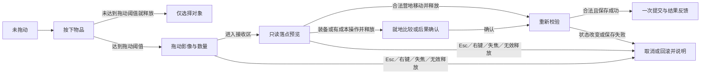

# 管理页操作、信息密度与可视化专项

2026-10-15 · 源码基线 `cda7b29` · Windows 鼠标／键盘、中文、1100×760 起；沿用现有木刻美术。按桌面近距离阅读设计，系统 DPI 和真人效率尚未实测。

**有明确的优化空间。优先调整空间分配、比较方式和操作上下文：仓储突出两个容器，装备突出差异，卡组突出构成，制作突出条件和产物，任务突出下一步。** 不宜把所有管理页统一成大卡片，也不宜通过缩小正文来提高密度。

本专项把已有建议细化到页面，另补 **16 项独立方案 A189–A204**，总清单为 **204 项**。原 A001–A188 保留。[完整方案清单](07_UI优化方案清单.md#management) · [可操作的布局示意](../media/ui-deep-audit-20261015/management-layouts.html) · [全部方案筛选看板](../media/ui-deep-audit-20261015/review.html)。示意只用于选择、筛选和阅读，数据为演示，不是游戏实机改造结果。

后续补充了[右键菜单、拖拽与悬浮的具体交互方案](#pointer-interactions)：细化现有 A086–A088、A143、A145、A184、A185，不重复增加编号，总数仍为 204。右键菜单、管理页拖拽及替代操作现已接入游戏，最新范围与验证见[实施记录](09_UI优化实施记录.md)；布局示意保留为实施前方案。

[信息分层与精简方案](#information-disclosure)规定哪些内容常驻、哪些随选择出现、哪些可展开，细化 A011、A064、A079、A099、A143、A184、A191。总数仍为 204；游戏已落地相应分层，本文保留方案及验收条件，实际效果以[本轮运行截图](../media/ui-completion-20261015/README.md)为准。

## 先处理什么

| 优先处理 | 当前依据 | 建议交付 |
| --- | --- | --- |
| 仓储把空间让给物品 | 当前穿戴固定占一整栏；空背包仍绘制全部空格；列表模式仍使用 106 高行 | 穿戴折为摘要；随身／仓库成对显示；真正紧凑的物品行；选中对象和执行后果保持可见。A079、A083、A189–A195 |
| 卡组一屏看清主要构成 | 1280 原图首屏完整显示约 4 个牌种，第 5 个只露出标题；每种牌重复名称、规则、来源和分隔线 | 一行一个牌种，副本与两种费用对齐；完整规则按需查看；点来源能看供牌关系。A064–A069、A196–A198 |
| 改装和背包改为可比较结构 | 改装原图首屏约 2 个完整大卡；背包页约 2 个完整方案，第 3 个未显示完；补给和扩仓在其后 | 改装按装备选择后比较；三种背包用同行对照表；补给与扩仓独立入口。A099–A110、A199–A201 |
| 制作、任务的主动作有完整上下文 | 配方成本／已持有同时出现；任务交付前的奖励与空间变化不在当前详情中完整呈现 | 制作显示条件摘要与产物去向；交付显示确定的消耗、奖励、容量变化；已完成状态收起历史成本。A093、A095、A096、A199、A200、A202 |

以上是 Warning（有明显操作或阅读负担）及 Opportunity（新增能力），不是一组新发现的严重故障。卡组按钮空回调是可定位的交互语义问题，列为 A196 修正；先前保存失败遮住操作的 A134 仍是 Critical／P0，应先解决。没有新增可访问性合规通过声明。

## 证据与密度判断

本次逐张重新查看了 8 张已有同版本截图，并复查相关 C#；没有重新运行游戏或生成新的游戏截图。截图反映指定存档状态，不能推广成所有页、所有字号的测量。

| 页面／证据 | 操作便利性 | 信息密度 | 可视化效果 |
| --- | --- | --- | --- |
| [仓储 1280](../media/ui-deep-audit-20261015/1280-cargo.png) | 同页取放和底部动作已经有效；上方将装备部位与物品类别排在同一行，层级不清 | 当前穿戴栏在这张图中约宽 232；空背包占据大块空间；48 格仓库继续绘制空格 | 物品轮廓有辨识度；容量、当前量与执行后变化仍主要靠文字拼接 |
| [装备 1100／大字](../media/ui-deep-audit-20261015/rework-1100-150-comparison.png) | 选候选、看差异、穿戴的路径已有；完整规则占用比较区域 | 三栏在大字下把详情压窄；重复展示变化卡与候选完整供牌 | 加入／移除已有颜色和文字，应继续强化同行差异，避免只显示“更强” |
| [角色卡组 1280](../media/ui-deep-audit-20261015/1280-character.png) | 卡牌名称是按钮，但点击回调为空，完整规则靠正文和说明层 | 少量牌种仍要滚动；左栏装备大图和主区重复来源占空间 | 已有攻击／防护／抽牌统计；分类重叠，不能画成互斥的占比饼图 |
| [装备制作 1280](../media/ui-deep-audit-20261015/1280-crafting.png) | 目录＋详情、制作后查看成品已经存在 | 已持有时仍显示成本、状态和大禁用按钮；可制作性需逐项打开 | 配方概念与真实成品缺少不同的视觉身份；材料“12/2”需要解释 |
| [供牌改装 1280](../media/ui-deep-audit-20261015/1280-mods.png) | 多个“购买并安装”并列出现，滚动后容易忘记操作的是哪件装备 | 每组约占大段纵向空间，背景和按钮与短规则不相称 | 基础／改装已并排，但同一字段缺少同行对齐；更适合差异表和一张副本替换图 |
| [背包与仓储](../media/ui-deep-audit-20261015/inventory-backpack-crafting.png) | 想做补给或扩仓，先滚过背包；已有背包仍是大卡 | 重复插画和禁用动作占高；更适合三行规格表 | 三种背包画面相近；总容量、自重、缺料、已持有应成为比较锚点 |
| [任务](../media/ui-deep-audit-20261015/12-journal.png) | 已有分类、目录、详情与可交付置顶；S10 状态矛盾沿用 A113 | 单任务详情只有几行却占整块区域；不应为填空而增加说明 | 状态文字、任务物位置、已知奖励和下一步可以构成短流程；未开放阶段不要伪造进度百分比 |
| [行前整备](../media/ui-deep-audit-20261015/01-preparation.png) | 最终检查和部署按钮已经固定；初始工具与携行清单在另一滚动区 | 只有两个部署候选，完整地图仍占主体；地图高度与清单争夺空间 | 当前量／出发量不同是正确规则，应以差量解释；仓库返还预留不能混入背包剩余格 |

关键源码：[页面与滚动恢复](../../game/Scripts/ChapterGame.cs)、[仓储](../../game/Scripts/ChapterGame.StorageUi.cs)、[106 高的格位与列表](../../game/Scripts/ChapterSlotGrid.cs)、[装备／制作／改装／任务](../../game/Scripts/ChapterGame.WorkspaceUi.cs)、[角色与整备](../../game/Scripts/ChapterGame.OverviewUi.cs)、[背包制作](../../game/Scripts/ChapterGame.InventoryUi.cs)。

### 密度应如何提高

“有效密度”指同屏能够识别、比较和操作的对象数。缺少名称、费用、状态或后果的图标堆叠不算有效密度。宽屏应优先增加比较信息，大字模式则允许减少列数；不能为了达成条目数指标把文字缩回小字。

下面的尺寸是**原型起点**，不是已通过实机验收的固定规格：

| 内容 | 建议起点 | 取舍 |
| --- | --- | --- |
| 目录行 | 一行名称＋一个短状态；短内容约 48–56 高，双行约 64–72，长名称可增高 | 不把完整效果塞进每一行；状态不能只有颜色 |
| 材料列表 | 图标、名称、随身、仓库、占格／重量对齐；只在选中时展开操作后果 | 紧凑模式缩减空白和重复解释，正文仍保持可读字号；图标浏览保留为另一视图 |
| 卡组列表 | 一行一个牌种，副本和行动／魔法分列；选中查看全文 | 按牌种计数而非把每张副本展开为一张大卡；两种费用不能相加成一个费用 |
| 详情区 | 对象名、短结论、关键差异在顶部；长规则折叠或单独滚动 | 换新对象先看其摘要，返回同一对象才恢复阅读位置 |
| 主动作区 | 对象＋数量＋后果＋一个主动作；次要动作在同一上下文 | 信息过多时折叠细节，不让动作区反过来吞掉列表视口 |

例如，假设容器有 448 高可用区域：现有行高 106、间距 6 的列表只能完整容纳约 4 行；若某类双行内容能在 64 高、间距 6 内完整表达，可容纳约 6 行。这是布局算例，不是游戏实测收益；实际还须扣除表头、边距并验证中文换行和大字。

## 便捷操作落地后的信息分层与精简

**可以精简，主要收益来自收起重复说明、非当前对象的完整详情和低频按钮。** 推荐默认呈现足以比较和选择的信息，选中后集中显示执行后果，再通过悬浮、固定详情和更多菜单补充内容。右键与拖拽缩短操作路径，普通点击和键盘仍应能找到所有必要功能。

这与 NN/G 的[渐进披露原则](https://www.nngroup.com/articles/progressive-disclosure/)一致：常用内容放在首层，次要内容按需打开，而且展开入口必须容易发现。本项目的具体取舍按下表执行，不据此假定所有详情都适合隐藏；需要反复共同比较的字段应同时可见。

### 信息放到哪里

| 展示时机 | 保留什么 | 具体例子 | 可访问路径 |
| --- | --- | --- | --- |
| 浏览时常驻 | 辨认、筛选和比较所必需的字段，当前场景与容器状态 | 名称、数量、配发／校准等必要标记；卡牌副本与费用；容器容量与负重 | 不需要先悬浮或点开每一项才能比较 |
| 选中后出现 | 当前对象的关键差异、本次数量、去向、后果及主动作 | 取放后空位／重量；换装失去的牌；制作材料和产物去向 | 当前页固定操作区或详情区，一处集中呈现，避免两处重复全文 |
| 悬浮／聚焦补充 | 简短解释、被省略的全名、图标含义、次要来源 | 同类物品的用途短句、关键词定义 | 鼠标和键盘都可触发；需要长读时能主动固定，不让悬浮成为唯一途径 |
| 主动展开／更多 | 低频命令、完整规则、历史与追溯信息 | 永久放弃、完整供牌、配方来源、已拥有物品的历史成本 | 明确的“详情”“完整供牌”“更多操作”等入口；右键是等价快捷入口 |
| 条件触发后保持可见 | 影响当前操作的阻塞、风险、错误及恢复方式 | 空间不足、超重行动变化、巡逻拦截、永久损失、保存失败 | 出现在相关操作旁；不能只放进悬浮、折叠区、菜单末尾或短暂通知 |

这些是并列的展示时机，**不是四五层导航**。从当前对象应能直接打开所需详情或菜单；如果为了查一项常用信息必须先展开、再开菜单、再进入另一页，应把这项信息提回当前页。核心字段即使配有图标，也保留必要数字、单位或文字。

### 逐页可以收起哪些内容

| 页面 | 默认保留 | 选中／执行前展示 | 可收纳或删除的重复内容 |
| --- | --- | --- | --- |
| 仓储 | 物品名称、数量、规则身份；随身／仓库容量；当前负重与筛选状态 | 本次数量、明确去向、操作后容量／重量、一个主要移动按钮与更多入口 | 当前穿戴折为摘要；每件物品的长用途按需看；空位默认只示余量；单件／整批／放弃等不必给每行铺开一组按钮 |
| 装备 | 当前部位、候选名、所在位置／可用状态、比较所需的简短属性 | 当前→候选的供牌增减、重量、旧装备去向及穿戴动作 | 已在差异区展示的规则不再全文重复；完整候选供牌和来源可展开；备用等次动作保留在更多入口 |
| 角色卡组 | 牌名、副本、行动／魔法费用、核心效果短句与关键条件标记 | 选中卡的完整规则、来源；需要比较时可固定两份信息 | 每种牌的多行完整规则、长来源名单与重复分隔装饰可收起；费用与影响判断的限制不能只靠悬浮 |
| 装备制作 | 配方名、产出概念、主要状态，能区分可制作／缺料／未解锁／已持有 | 当前配方的真实材料消耗、确定产出、去向、空间和首要阻塞 | 非当前配方的长成本不铺开；已持有时收起历史成本和禁用制作大按钮，改为查看成品 |
| 供牌改装 | 装备与当前生效方案；其他方案的拥有／安装状态 | 所选方案的副本替换、效果取舍、购买范围与本次费用 | “每件一个改装位”等共用规则只说明一次；每件装备不再常驻整张前后对照大卡及购买按钮 |
| 背包／补给／扩仓 | 三类任务入口；背包的总容量、自重和状态可同行比较 | 所选方案成本、换包后果，或补给产量、扩仓后容量 | 重复背包插画和已拥有大卡可压缩；未选中的材料明细收起；总容量、自重不能被折叠后失去横向比较能力 |
| 任务／日志 | 任务名称、阶段、下一步、可交付状态；日志组摘要 | 已知交付消耗、奖励和容量变化；选中记录的原始内容 | 背景叙事、已完成步骤和长历史按需展开；同一全局目标不在页头、目录、详情重复整段；阻塞和未知后续仍明确标示 |
| 行前整备 | 拟部署点、目标、携行摘要、出发空位／负重、仓库返还预留与部署入口 | 初次工具比较、问题定位、必要的变化说明 | 完整路线图、四槽大图、无变化的长穿戴说明可展开；清单正常项可汇总，异常项必须直接列出 |

“一个主要按钮”是默认布局建议，不强行把所有任务塞进同一动作。需要同时比较的穿戴和备用结果可以并列显示短说明；低频动作仍从可见的更多按钮访问。菜单打开后再重复一套永久底栏按钮没有必要，但主动作和非拖动路径不能消失。

### 仓储精简后的结构示例

页面主体保留“随身”和“仓库”两个明确区域，上方统一放名称、容量、负重与筛选；物品行只承担识别和比较。底部是一处与所选对象绑定的短操作区：

| 区域 | 精简后的示例内容 |
| --- | --- |
| 物品行 | 废钢 · ×12 · 普通材料；其他规则身份有差异时明确标记 |
| 选中摘要 | 已选：仓库废钢 · 本次 3 件 · 仓库→随身 |
| 执行后果 | 随身占格：当前→预览 · 负重：当前→预览；各数值由真实规则生成 |
| 主要操作 | 数量控件 · “带入 3 件” · “更多操作” |
| 更多／详情 | 整批移动、已知用途／来源、低频管理命令；永久放弃保留独立确认 |

这里不把物品行的 ×12 当成这次一定移动 12 件，也不假定移动 3 件就占 3 格。悬浮可补充用途；拖动时影像与目标容器复用同一份数量和结果预览，不能因底栏变短而丢失费用与数量语义。

无主动选择时可以显示一条简短选物提示；选中后显示操作上下文。切换同类对象时，主要按钮的位置、含义和区域尺寸保持稳定。拖动开始后不要展开或收起侧栏、改变目标容器位置；悬浮也不改变列表行高。确需显示新错误时占用明确的状态区，并取消不再合法的手势。

### 精简可以按依赖逐步进行

1. **先删重复、合并布局。** 共用规则只说一次，历史成本按状态收起，目录不重复全文，空位改容量摘要。这部分可在现有选择和详情入口上先做，不必等拖拽完成。
2. **再把低频动作移入菜单。** 先验证可见更多入口、键盘入口、对象身份和禁用原因，再减少重复次按钮；主操作继续可见。
3. **让长说明按需阅读。** 先有可主动打开、固定、滚动和关闭的详情，再收起逐行长文。短悬浮只辅助扫读，避免把理解构筑变成逐个找提示。
4. **加入拖拽并保持稳定。** 拖拽使用相同命令与预览，不改变基本信息契约；发生误触、目标难找或需要频繁展开时，恢复相应的直接入口。

舒适／紧凑模式只调整间距与行高策略，阅读字号独立。信息分层按任务设计，避免再增加一套会暗中隐藏关键信息的“专家模式”。新玩家从可见主操作、更多与详情即可完成流程，熟练玩家再使用右键和拖拽。

### 怎样确认精简确实有效

| 任务 | 可接受的结果 | 需要退回或调整的现象 |
| --- | --- | --- |
| 不悬浮地浏览物资、配方或卡牌 | 可以辨认对象、比较常用字段、找出主要状态 | 物品只能靠图标认；要逐项悬浮才能知道费用、数量或是否可制作 |
| 选中后准备执行 | 本次数量、去向、必要费用和关键后果集中可见，主动作可以直接找到 | 底栏只剩孤立按钮，风险要到更多菜单中查 |
| 阅读完整规则 | 从所选对象一次明确打开同页详情，能固定、滚动并返回 | 为比较两件物品反复开关弹层，或指针一动内容就消失 |
| 连续移动／比较多个对象 | 列表、落点和主动作稳定，实际任务的滚动或指针往返减少 | 为节省高度导致操作区不断伸缩，按钮位置改变后误点 |
| 键盘或纯鼠标点击完成流程 | 不使用拖拽与右键仍能完成同一任务，且无需探索隐藏手势 | 必要命令只存在于右键，或只能持续拖动才能移动物品 |
| 满包、超重、巡逻或保存失败 | 简洁布局仍直接呈现问题与恢复路径 | 错误被摘要折叠或短通知吞掉，玩家只能反复试错 |

记录同一场景下的首屏完整对象数、可见重复按钮／说明、滚动、跨页、展开详情次数及误操作。不能只用减少多少文字或按钮来判定成功；如果常用任务需要更频繁打开详情，就应将对应字段恢复常驻。本轮没有真实用户用时、错误率或面积节省比例，以上均为设计与验收目标。

## 按页面安排操作与信息

### 仓储：围绕“把什么从哪里移到哪里”

保留随身与仓库同时可见。顶部只留“物资／装备”的工作模式，物资内部再放类别、搜索、排序和视图开关；部位筛选只在装备模式出现。默认把当前穿戴收为摘要，点击展开原来的四槽，腾出的宽度给两边的物品。

常用整理采用成对数量表：每个物品一行，分别显示随身和仓库数量；选择单元格即明确来源。涉及配发、校准、登记或不同批次时继续分行，不以同名合并规则不同的实物。网格适合辨认物品外形，表格适合比较数量，两种视图共享同一操作对象。对应 A078、A083、A085–A091、A147–A153、A189、A190、A193。

容量可画“当前占用／本次变化／剩余”分段条，仍保留精确格数；由于堆叠取整，数量减半不代表占格减半。重量另用带 20 kg 阈值的标尺；达到上限和超过上限需要遵循实际比较条件，超重段不能被满条裁掉。不可把仓库的 48 格误画成需要手动俄罗斯方块整理的布局。对应 A194、A195。

### 装备：围绕“换了以后得到什么、失去什么”

使用“部位／候选列表＋比较详情”。当前装备放在比较头，候选放旁边；变化卡优先，完整供牌默认可展开。每个比较行固定为“字段｜当前｜候选｜变化”，重量下降只写减少多少，不能据此推断整体更强。背包比较容量，武器比较供牌，不能强行放进相同的空属性表。对应 A071–A077。

“穿戴”和“带作备用”保留不同结果说明：前者改变供牌，后者只搬入随身并占空间。确认前展示整套负重与旧装备去向；“不能穿戴”至少说明当前真正阻塞条件。切换候选时，候选列表位置保留，右侧详情回到新的差异摘要，避免带着上一件装备的滚动位置看新对象。对应 A074、A075、A192。

### 角色卡组：围绕“这套构筑有哪些能力、来自哪里”

主区采用紧凑牌种表；费用条和功能数量只占一小块摘要，点击摘要可以筛选对应卡种。攻击、防护、抽牌可能重叠，使用独立数量条，不能画总和为 100% 的饼图；行动费与魔法费分别统计，也不能混作一条费用曲线。对应 A064–A069。

来源可视化用小矩阵或来源标签：装备在行、卡种在列，数字表示提供几张；选装备高亮它提供的牌，选牌高亮贡献装备。相同卡由多件装备提供时按真实副本数分配；临时牌或试用借装有独立来源。矩阵默认按需展开，不能取代更易读的卡表。卡名点击应打开明确详情或固定说明，不能给玩家一个没有明确动作的按钮。对应 A196–A198。

### 装备制作：围绕“现在能不能做，做完在哪里”

目录显示可制作、缺料、未解锁、已持有等主要状态；所选配方详情顶部显示简短条件清单：解锁、材料、成品空间、拥有状态。多个问题同时存在时，先告诉玩家当前阻塞，再展开其他条件，不把未到阶段的材料全部渲染为紧急红色。对应 A092–A098、A199。

材料用“拥有 → 消耗 → 剩余”表，短缺单独列数；原料的件数不能直接相加画成总材料进度。配方入口使用图纸或说明标记，实际成品使用库存物品样式及位置，区分“知道怎么做”与“已经持有”。成品已拥有后，主动作变为查看／比较，历史成本收起。对应 A093、A096、A160、A200。

### 供牌改装：围绕“哪件装备的一张牌被替换”

按装备选择后只显示该装备的基础／方案；左侧标示未购、已购未装、已安装，右侧固定比较和动作。用“基础副本 ×3 → 基础 ×2＋改装 ×1”这类副本关系图解释替换，实际数字由真实装备生成，不能默认每件都有三张基础牌。对应 A099、A100、A102、A104。

效果差异按行动、魔法、伤害、护盾、抽牌逐行对齐；“少护盾、换抽牌”表达为取舍。只突出改变的字段，条件性效果保留触发条件。购买需材料，已购切换免费，两种操作的外观和文字都应明确。不要为每个方案重复一整张装饰大卡。对应 A101、A103、A105。

### 背包、补给、扩仓：按三种任务拆开

背包页让三种方案同行比较：总容量、自重、当前空余预测、状态和成本。选择某行后展开完整成本和换包后果；一件已拥有背包不必占整屏三分之一。总容量包含基础口袋，已有规则按 A107 显示；不是只加一个数字后保留原大卡。对应 A106–A110、A201。

补给页优先显示实际产出数、消耗、仓库空间；普通补给与本趟配发保持不同来源标记。扩仓页显示当前／升级后容量和前置条件。成本、规则和状态都可以共用组件，但不要让玩家查扩仓时先滚过所有背包。对应 A106、A110、A111、A164。

### 任务、日志与发现：围绕“下一步是什么”

任务正文使用“状态 → 下一步 → 相关物品位置 → 已知奖励／交付后果”的顺序。只有一个任务时可以留白，不为填满右侧而重复背景；已完成任务进入记录样式，不保留待完成的动作语气。交付之前就显示确定消耗、奖励去向、容量变化，隐藏剧情只标为未知后续。对应 A010、A113–A117、A202。

日志沿用 A118 的明确事件类型，再按远征／地点或同一操作组折叠，组标题显示结果；展开能逐条看时间顺序，不能把两次独立消费压成一次。发现页保留人物／地点缩略与来源，不把未知线索画成已完成进度。对应 A119、A182、A203。

### 整备：围绕“准备好了没有，去哪里”

当只有一两个部署点时，默认用紧凑地点卡与下一目标，完整地图可展开；玩家要核对路线时仍能原地打开，不自动移动。地图释放的高度用于出发清单和异常项，初次选工具时保留必要比较。对应 A029、A030、A157、A204。

显示三种独立结果：出发背包剩余格、含配发的出发负重、仓库返还预留。预留属于仓库约束，不是额外塞进背包的物资；超重是费用变化，不等同于无法部署。检查项能定位到具体对象，处理后返回原方案。对应 A031–A034、A074、A157。

## 哪些可视化有用，哪些应避免

| 需要回答的问题 | 适合的图形 | 显示规则 |
| --- | --- | --- |
| 还能放多少，这次取放会怎样 | 带数值的容量分段条＋变化标记 | 用真实预览结果算格位；当前、预测、空余有文字或纹理区分 |
| 是否越过负重门槛 | 20 kg 阈值标尺＋当前／预测刻度 | 同时保留精确重量；超过阈值画出超出部分及真实行动后果 |
| 换装改变哪些牌 | 当前／候选对照表，增减副本标签 | 不变项可收起；移除的能力不能被净总数抵消后隐藏 |
| 哪件装备提供这张牌 | 来源数量矩阵或联动高亮 | 不猜临时牌来源；不能把“有这张牌”误算成所有同类副本均由这件提供 |
| 构筑费用是否集中 | 行动费、魔法费分别画数量条 | 以副本数计；功能标签可重叠，不转成互斥份额 |
| 制作被什么阻塞 | 短条件清单＋逐材料缺口 | 不使用毫无依据的综合“完成度 78%”；不同材料不按件数相加 |
| 任务到哪一步 | 已知阶段清单与当前下一步 | 不给未知阶段编总数；完成、可交付、待解锁使用不同文字 |

不建议增加总战力、装备雷达图、攻击／防护重叠饼图、只靠红绿的优劣判断、所有页面的大图仪表盘。它们可能增加视觉吸引力，却无法从当前规则得到可靠结论。美术应保留在物品轮廓、标题、人物和主要分区，密集比较区使用安静的底色和对齐。

## 右键菜单、拖拽和悬浮可以改善哪些操作

**可以，而且适合分成三种职责：悬浮负责快速查看，右键负责就地选择动作，拖拽负责表达来源和目标。** 单击继续负责选择，主动作仍能从可见按钮完成。最先做“短说明＋对象菜单”，其次做营地跨容器拖拽，再评估装备槽与野外流程；不用一次把全部管理页改成拖放操作。

当前并非完全没有悬浮或快捷操作：[说明层](../../game/Scripts/ChapterGame.GraphicUi.cs)已响应鼠标进入与键盘聚焦；[仓储格子](../../game/Scripts/ChapterGame.StorageUi.cs)特意清空悬浮文案，把详情放到底栏；[输入处理](../../game/Scripts/ChapterGame.Interactions.cs)已有 Shift+Enter 整批取放。本轮源码检查没有发现第一章管理页的右键菜单或拖放接收实现。这些是现状与新增机会，不能把“所有格子加提示”当作已经验证有效的修正。

### 按页面分配手势

| 对象／页面 | 悬浮或键盘聚焦 | 右键／更多操作菜单 | 拖拽的适用范围 |
| --- | --- | --- | --- |
| 仓储材料、补给 | 完整名称、规则身份、数量、用途；当前操作的容量／重量变化 | 带入／存仓、选择数量、整批移动、查看用途；已实现保留标记后才增加相应菜单项 | 营地随身↔仓库最适合先做；目标是整个容器，不要求精确扔进空格 |
| 野外地面物品 | 来源容器、当前免费状态、拾取费用、巡逻是否会先打断 | 拾取 1、选择数量、拾取该容器的合法批量、查看用途 | 后续阶段再开放；释放后显示本次数量、费用和后果，不能跨容器合并成一次费用 |
| 装备候选／穿戴槽 | 候选相对当前的供牌增减、重量和可换装条件 | 比较／穿戴、带作备用、查看供牌、定位实物；不可用项解释原因 | 拖到匹配部位进入换装比较；拖到背包是携带，不是穿戴；不匹配部位拒绝 |
| 角色卡组 | 短效果、行动／魔法费用、来源与副本数 | 固定详情、按来源查看、筛选同类牌；不提供当前规则没有的“移除卡牌” | 管理页拖牌不改变真实构筑；若做自定义顺序，必须注明仅调整显示，单独评估 |
| 制作配方／材料成本 | 配方状态、缺口、实际产出；材料可继续查看已知用途／来源 | 查看材料、追踪配方、查看已有成品；“制作”仍有明确成本和产物上下文 | 不用把配方拖进背包来隐式制作，也不要求拖材料到配方才能制作；材料汇总已存在 |
| 改装方案 | 哪一张副本被替换、具体取舍、已购与生效状态 | 查看差异、购买并安装、安装已购、切回基础；动作依状态区分 | 暂不做“拖到装备即购买”；可后续做只读预览，但不能绕过成本与购买范围 |
| 任务／日志 | 短下一步、相关物品位置、已公开奖励 | 追踪、地图定位、查看相关物品／回执；交付保留明确结果预览 | 不用拖任务物到任务卡自动交付；自定义任务排列可后续评估，不影响任务顺序规则 |
| 整备／部署点 | 当前量与出发量的差异、地点条件、任务物缺口 | 定位阻塞物品、查看装备、管理补给 | 把合法物品加入携行清单可复用转移规则；拖拽地图节点不部署，也不自动移动 |

上述“保留”“追踪”“数量输入”等部分本身也是待实施功能。菜单只能接入当轮已经具备的命令，不能先做一批无效入口。对低频内容，文字按钮通常比隐藏手势更易发现。

### 右键菜单：省掉到远处找按钮的过程

菜单建议由对象、来源、数量和场景共同生成。标题例如“仓库 · 废钢 ×12”，常用动作就近列出，顺序保持稳定：查看／比较、移动、数量与批量、其他；永久丢弃单独分组，名称带省略号并进入既有确认。营地没有行动费用的合法移动可直接执行，不为所有移动新增通用确认框。

| 情况 | 应有行为 |
| --- | --- |
| 右键一个未选中的普通物品 | 选中并明确高亮该物品后打开菜单，菜单目标不沿用之前的底栏对象 |
| 右键已在多选组内的物品 | 保留整组，标题写清所选项数；只提供全组支持的动作，混合限制说明涉及哪些项 |
| 右键多选组外的物品 | 明确切成“仅此物品”的菜单并同步选择状态；不能暗中对旧多选组执行 |
| 空间不足或地点不允许 | 仍能阅读相关动作及具体禁用原因；与该对象无关的命令不放进菜单 |
| 点击菜单外、按 Esc | 仅关闭菜单，恢复对象焦点；用于关闭的同一次输入不继续触发背后的危险动作 |
| 菜单打开后对象数量或场景变化 | 旧菜单失效，要求重新查看；不能静默改成另一批或另一数量执行 |
| 不使用右键 | 对象旁“更多”按钮、菜单键／Shift+F10 可打开同一菜单；方向键选项、Enter 执行、Esc 返回 |

不建议嵌套多层子菜单。菜单只保留短动作与必要的后果；长比较、数量编辑和材料来源进入有固定标题的详情或小面板。按钮、菜单和快捷键必须显示同一命令名称、数量及费用。

### 拖拽：先把数量和落点说清楚

**第一阶段只做营地跨容器移动。** A078 的“图块／批次／聚合数量”必须先统一，否则拖着一个写 ×2 的尾堆，却移动另一批 ×10，会放大当前对象语义问题。

默认拖动整批，或拖动玩家已经明确设定的数量；拖动影像始终显示对象名、数量和来源。部分移动先从“选择数量…”或同等可见控件设定。不要把 Shift 同时定义为快速转移、范围多选和拖一半；保留现有 Shift+Enter 语义，后续改键由 A137 统一处理。

| 落点／状态 | 预览 | 松开后的行为 |
| --- | --- | --- |
| 营地合法的另一容器 | 整个接收区高亮；显示来源→去向、本次数量、两端占格和负重变化 | 重新校验后执行一次移动；成功后标记到达物品，来源与目标滚动稳定 |
| 原容器、空白、错误部位、不可访问容器 | 显示拒绝符号与短原因，不只改变颜色 | 取消，物品仍在原处；空白区域不等于丢弃 |
| 目标装不下整批 | 指出缺多少容量；允许取消后选择数量或使用“最大可放入” | 默认整次不执行，不擅自减少数量；确认新数量后才重做预览 |
| 合法装备槽 | 当前→候选、供牌得失、旧装备去向、换装后容量／重量 | 第一版先进入就地比较，再由玩家确认穿戴；不能把拖入背包解释为穿戴 |
| 野外地面或背包 | 实际取放费用、免费窗口状态、巡逻中断结果 | 后续开放时先进入结果预览；确认仍调用原规则，不能承诺“松开必定拿到” |
| 多选物品 | 展示对象数、总件数及各项是否合法 | 留到单物品和批量命令成熟后；营地使用明确批量语义，野外不自行拼成一个免费动作 |

拖到合法落点只表达意图，最终执行仍要检查状态是否变化。拖动期间不能先把实物从库存移走，再寄希望于失败时搬回；拖动影像也不应冒用真实物品数量。已有的可逆移动不意味着制作、购买、任务交付也能使用相同的直接提交方式。

拖动识别需要位移阈值，按实际 UI 缩放和设备验证，不能把按下瞬间当成拖动。拖拽中右键只取消该次拖动，不同时弹出物品菜单；Esc、窗口失焦、对象失效和页面切换也取消。临近列表边缘可做受控自动滚动，但不靠停留在页签上自动换到另一个管理页。最终释放必须归属于本次拖动，不能再触发落点下方按钮。

### 悬浮：用短提示减少展开，用固定详情承载长阅读

当前仓储关闭格子提示是为了避免遮挡邻近物品，新增悬浮应保留这个目的。建议分为两层：

| 层级 | 内容与行为 | 如何退出 |
| --- | --- | --- |
| 轻量提示 | 鼠标短暂停留后显示完整名称、数量／规则身份、一句用途或当前比较差异；键盘聚焦也能查看 | Esc 可关闭；指针离开对象与提示区域后关闭；不会计时到一半强制消失 |
| 固定详情／比较 | 通过单击、菜单“固定查看”或键盘主动打开；可滚动全文、查看来源、展开相关说明 | 有明确关闭入口，关闭回到原对象；支持鼠标移入和键盘操作，不依赖持续悬浮 |

轻量提示不放必须点击的小按钮；需要互动就进入固定详情。文字随阅读字号变化，靠近屏幕边缘自动换方向。把提示放在对象侧边、避免盖住相邻条目和主动作；同一时刻只显示一个被动提示。鼠标移入提示本身时应仍可阅读，不能因为离开原物品就闪退。

菜单打开或正在拖拽时，普通悬浮让位于菜单／落点预览；已经固定的比较不被路过另一物品的鼠标改写。悬浮始终不改变实际选择、库存、费用、拾取窗口或键盘焦点。涉及永久损失、真实费用和限制的信息还要在执行上下文中出现，不能要求玩家悬浮后才知道。

### 三种手势共用一套状态与命令

| 需要统一的内容 | 本项目的实现边界 |
| --- | --- |
| 操作对象 | 使用稳定物品／批次身份、来源、目标和数量；不能以控件索引或画面中的第几个格子当成实物身份 |
| 规则与预览 | 底栏、菜单、快移和拖拽使用同一可用性判断、只读预览与执行入口；预览不能改变真实游戏状态 |
| 页面重建 | 当前 Render 会销毁并重建根控件；拖动期间需要延后非必要展示重建，或在重建前显式取消手势，不能继续引用旧控件 |
| 说明层 | 当前 `_inspection` 忽略鼠标输入，不宜直接往里面加可点击操作；固定详情需要独立、明确的输入与焦点处理 |
| 执行与保存 | 一次手势只提交一次；失败保留正确库存并说明未执行／已回滚；不能在回放或弹窗结束后补发积压操作 |
| 等价路径 | 提供“选物品→选移动／穿戴→选目标→确认”的点击路径及完整键盘路径；拖不动也能完成同一操作 |

Godot 的 [Control 官方文档](https://docs.godotengine.org/en/stable/classes/class_control.html)提供拖动数据、落点判断和释放接收接口，因此引擎层面具备实现基础；具体仍需结合项目当前 Godot.NET 版本和整页重建方式验证。这里没有编译或实现这些行为。

说明层的可关闭、可移入、可持续阅读，可参考 W3C [悬浮／聚焦内容说明](https://www.w3.org/WAI/WCAG22/Understanding/content-on-hover-or-focus.html)。拖拽应有无需持续按住的点击替代，可参考 [拖动操作说明](https://www.w3.org/WAI/WCAG22/Understanding/dragging-movements.html)；只有键盘替代并不能帮助所有难以拖动、但仍使用鼠标的玩家。这里借鉴交互要求，不据此宣称游戏已经通过可访问性审查。

### 推荐实施顺序与专项验收

第一轮做短提示、固定详情和右键菜单，复用现有取放／比较功能，收益主要来自减少点击后等待和指针往返。第二轮在 A078 对象统一后做营地单物品拖拽，配套数量选择、有效落点、取消与到达反馈。第三轮再评估装备槽、野外和多选；制作、改装购买、任务交付优先保留显式动作。

| 场景 | 验收重点 |
| --- | --- |
| 右键另一物品、右键多选内／外 | 菜单标题、选中高亮、执行目标和数量完全一致；禁用原因可阅读 |
| 小幅抖动、正常拖动、双击 | 抖动仍是选择；识别为拖动后不再触发单击；双击不默认提交付费／丢弃动作 |
| 空仓、满仓、只能放一部分、同名不同批次 | 默认整批不被暗中裁成部分；所有预览和执行对应同一实际对象 |
| 拖到原处、空白、错误槽位 | 原库存不变；不掉落、不销毁，也不触发落点下方按钮 |
| Esc、右键、失焦、页面重建、保存失败 | 手势或提交正确取消／回滚；恢复选择与阅读位置；无重复执行 |
| 野外有费用、免费窗口、巡逻打断 | 不因悬浮／拖动消耗行动或结束窗口；最终执行沿用真实费用和中断顺序 |
| 鼠标快速扫过、进入提示、固定后查看另一项 | 不闪烁、不覆盖关键操作、不改写固定对象；大字内容完整可访问 |
| 仅鼠标点击、仅键盘、缩放后的拖动 | 三种输入可完成同一合法任务；不依赖隐藏手势或连续长按；记录真实步骤和误操作 |

这些是未来验收条件；本轮只细化设计，没有进行这些游戏输入路径的实际验证。现有布局示意和历史截图不能证明右键、拖拽、悬浮联动已经可用。

## 对照其他游戏的具体依据

| 官方资料 | 资料中明确的做法 | 本项目的借鉴判断 |
| --- | --- | --- |
| 《异星工厂》[FFF-338](https://www.factorio.com/blog/post/fff-338) | 将物流等内容移到独立页签，搜索覆盖配方、库存和物流请求；公告也记录了界面改造的规模成本 | 按当前任务配置空间；保留关联查询，避免把全部模块一直铺开。先拆最有负担的管理流程，不做全局大换壳 |
| 《异星工厂》[FFF-426](https://www.factorio.com/blog/post/fff-426) | 将配方信息与实际产物槽分开，各自打开对应说明；复杂产量通过说明提供实际计算结果 | 区分配方与成品；显示真实制作后余量，避免玩家手算。这里不照搬生产速度、机械物流等系统 |
| 《炉石传说》[收藏管理官方说明](https://news.blizzard.com/en-gb/article/21790299/managing-the-collection-manager) | 支持按费用、属性、拥有数量和关键词缩小集合 | 把玩家想比较的字段做成可见筛选；本作以行动／魔法两种费用分别处理，不要求新手学习查询语法 |
| 《博德之门 3》[Patch 6](https://baldursgate3.game/news/patch-6-now-live_108) | 交易中可访问全队库存，减少为取用相关物品而切换角色 | 将当前任务所需信息放在同一工作区；借鉴关联访问，不引入本作没有的队伍交易 |

这些来源核对于 2026-10-15，描述的是相应公告版本的机制。布局、密度和图形建议是本项目的迁移判断，不是竞品实测，也不是“这些游戏受欢迎所以某种布局必然正确”的结论。

## 先试哪一组，怎样验收

第一组建议做**仓储＋角色卡组**：复用已有内容，收益容易观察。仓储完成 A078 对象一致性后，再做摘要栏、双容器数量比较、容量／负重预览；卡组先完成紧凑牌表与明确详情，再考虑来源矩阵。第二组做**改装＋背包制作**，把纵向大卡改为选择＋比较。第三组做制作条件、交付后果和整备地图折叠。

| 验收任务 | 完成条件 |
| --- | --- |
| 找到指定物资并比较两处库存 | 不离开仓储就能回答随身量、仓库量、来源、取放后空位；配发／校准批次不混淆 |
| 比较两件同部位装备 | 第一屏能读到增加、失去、总负重及旧装备去向；不会只看到总牌数相同就误判没有变化 |
| 查一张卡及其来源 | 常规样例主要牌种可同时比较；一次打开详情后可读全文；借装／临时牌不混入常驻装备来源 |
| 比较背包、查补给或扩仓 | 三种背包无需逐大卡来回滚；补给和扩仓各有直达入口；总容量与自重可直接比较 |
| 制作或交付前判断后果 | 当前阻塞、确定消耗、产物／奖励去向及容量变化在执行前可见；未知剧情不泄露 |
| 调整字号与密度 | 1100×760 大字仍能访问全部信息和主动作；紧凑模式不缩小正文；窄布局不依赖横向滚动阅读重要字段 |

对同一存档副本分别记录首屏完整对象数、跨页次数、滚动次数、指针往返、误操作与恢复；不能只统计点击数。布局示意的浏览器检查仅证明示意页面可用，不能替代 Godot 后台功能验证、离屏实机截图和真人试用。新交互按 A188 的自然输入路径验证，禁止用辅助聚焦掩盖不可达问题。
