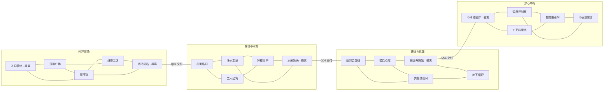

# 第一章区域与远征

> 设计提案；地点、行动、掉落与压力均未实现。[章节入口](01_章节总案.md)。装备 G、材料 M、任务 Q／S、任务道具 T、敌人 E 的定义分别见同目录内容表。

地图包含 20 个地点，分为四片相邻区域；余火站是独立据点，不计入 20 地点。一次远征一般围绕一个主目标和一个可选机会行动，不鼓励把全图清完。地点连接固定，常规运输与搜索分布有小幅变化。

## 1. 地图连接与解锁

所有边都是双向移动，每边 1 步。图外不存在默认捷径。未解锁边显示门槛和负责的任务；门槛只限制前往新区域，不阻断已进入区域的返程。

| 撤离点 | 首次启用 | 永久效果 | 出发点解锁 |
| --- | --- | --- | --- |
| A01 | 默认可用 | 始终免费、安全撤离 | 默认 |
| A05 | 完成 S01 的现场线路修复，1 步，不消耗背包材料 | 本次立即可撤；以后持续可用 | S01 成功交付后 |
| B05 | Q03 进行中即开放修复；现场扳动排水闸 1 步 | 永久启用码头 | Q03 交付且码头已修复 |
| C04 | 首次从 C02 到达后启动手动机组，1 步 | 永久启用升降站；不要求先打首领 | Q05 交付且升降站已修复 |
| D01 | Q05 开门后默认可用 | 中枢入口始终能退出 | Q06 交付后 |

据点只允许选择已解锁出发点。前进站运输已包含往返服务，不收费，不增加远征压力；抵达时满血与基础补给按统一出发规则结算。玩家可选择老入口，但不会被迫每次重走货场。

## 2. 地点内容表

表中“常规战”表示当前远征最多触发一次，清除后同次不刷新。任务目标与首获奖励固定，随机事件不能覆盖它们。搜索来源和保底规则见材料文档。

| 地点 | 核心交互及步数 | 战斗或风险 | 确定内容与回访价值 |
| --- | --- | --- | --- |
| A01 入口营地 | 查看路线 0；撤离 0；教学领取借用武器 0 | 安全；不能休息刷回血 | 第一次撤离教学；开局指向 A03，不要求先清广场 |
| A02 货运广场 | 检查货单 1；开货箱分 2 步；取 T02 1；挑战运输队 1 | K01；开箱第 1 步噪声预警，第 2 步由玩家决定 | T02、M01/M03；Q02 进行中即开放精英 E13 运货事件，首胜 G03 |
| A03 废料场 | 搜补给 1；拆废机 1；取继电器 1 | 首次教学 K02 可绕行；深层废机有明确战斗标识 | T01、M01、固定一份补给；首个材料搜索首获 M01×4、M02×2 |
| A04 维修工坊 | 启动台架 1；换装 0；选共鸣 1；校准夹具 1 | 无强制战斗；噪声不会在此直接锁战 | 已携带装备换装；S01 线索免费阅读；Q02 交付后开放制作（限据点） |
| A05 外环货站 | 线路修复 1；取路签 1；撤离 0 | 修复前可原路退回；无守门战 | T11、永久出口、通往 B01；固定 M02×2 搜索点 |
| B01 灰街路口 | 调查足迹 1；搜岗哨 1；选择绕行出口 0 | K03；路线公开后可避开 | G04 的来源情报；M03；介绍多段攻击与连携 |
| B02 工人公寓 | 搜药柜 1；搜住户箱 1；整理名册 1 | K04 只挡住深层箱，名册可绕路取得 | T10、M03/M05；Q03 前可访问；S02 首奖 G04 |
| B03 净水泵站 | 关泄流阀 1；取滤芯 1；搜线圈 1；选共鸣 1 | K05；关阀使水蛭从 2 只减为 1 只 | T03、M02/M05；Q03 固定奖励 G11；阀门本局重置 |
| B04 钟楼岗亭 | 查看排班 1；切旁路哨灯 1；挑战司闸者 1 | E14；哨灯未切时有 E07 支援 | T04、首胜 G12；可选保险箱 M03/M04；精英可在章后复战 |
| B05 水闸码头 | 排水修复 1；打捞漂箱 1；撤离 0 | 漂箱风险在操作前公开；码头本身安全 | 永久出口；M04；通往 C01；回访可接居民运输事件 |
| C01 运河装卸道 | 查看货运牌 1；截货挑战 1；搜运货箱 1；搜独立装备箱 1 | K06；自愿接受高价值货物追踪 | M02/M04；首个独立装备箱固定 G06；普通路线可直接去 C03 |
| C02 模具仓库 | 搜余料 1；取底座分 2 步；开额外装备库 1 | K07 只保护额外装备库；取底座第一步先预警 | T05、M01/M04；完成取底座后首获 G13；通往安全 C04 |
| C03 共振试验间 | 台架换装 0（启用 1）；校准仪器 2；切警钟 1；选共鸣 1 | E15 为 S03；Q06 后出现备用炉芯挑战 K11 | T12、后期 T09；M05/M06；切警钟影响 C05；不与首领奖励互斥 |
| C04 货运升降站 | 启动机组 1；S04 检查负载 1；撤离 0 | 安全；启动可在首领前完成 | 永久出口；S04 装备奖励；Q05 后通往 D01 |
| C05 地下熔炉 | 查看守卫构造 0（首次实地）；挑战 1；取校准记录 1；可选炉箱 1 | E17；支援由 C03 警钟决定，战前完整列出 | T06、首胜 G07、M06；炉箱额外材料需回头带走 |
| D01 中枢接驳厅 | 选入口路线 0；查看供能图 0；撤离 0 | 安全 | 前进撤离点；Q06 后可从据点直接抵达 |
| D02 工艺档案馆 | 阅读档案 1；取接线图 1；取桥接件 1 | K08 保护材料库，主线图纸可不战取走 | T07、T08×1、M05；档案保留文字知识，图纸仍需撤离 |
| D03 调度控制室 | 改道巡逻 1；取桥接件 1；开高级柜 2；选共鸣 1 | E16 只挡高级柜；K09 为可选分区巡逻 | T08×1、首胜 E16 给 G23；每次远征可改道一次，使巡逻避开一条选定边 3 步 |
| D04 屏障避难所 | 对话 0；设置供能方案 2；接护送 1；治疗 1 | 不发生随机战斗；S06 在相邻路线触发 K10 | Q07 供能分支、S06、固定治疗 10（每次远征仅一次） |
| D05 中央稳压井 | 查看设施 0；挑战 1；拆卸装置 2 | E18；战后仅产生预告的返程巡逻，不立即开战 | 最终稳压装置、G24；最近 D01 为 D05→D03→D01 两步 |

同地点可以有三种交互，但主线推进不会要求清空所有按钮。已搜过的对象显示耗尽，免费反复查看不会刷新奖励。

## 3. 三条路线示例

| 阶段与目的 | 路线 | 主要选择 |
| --- | --- | --- |
| 初次带回继电器 | A01→A03→A04→A02→A01 | 拿到 T01 后可直接 A03→A01；工坊与货箱只是额外目标 |
| 水务区装备与任务 | A05→B01→B03→B05→B04→B02→B01→A05 | Q03 进行中即可修 B05 并直接撤离；交付后可从 B05 出发挑战 B04，不必一趟走完 |
| 首领前先留退路 | B05→C01→C02→C04→C05→C04 | C04 先启用；若想断警钟，C02→C03→C05，多做一项准备 |
| 最终带货 | D01→D02→D04→D05→D03→D01 | 战前设置分流；战后撤离只有两次移动，可绕去 D04 进行剧情收尾但不是要求 |

先前收集的 T08 可以从仓库作为“任务携带品”带入，明确放入本局风险清单。每次只携带当前目标需要的数量，不能自动把仓库全部任务物带出。

## 4. 行动时间与轻度压力

采用区域压力 P，初始 0。移动、搜索阶段、现场设施、喝补给、发现共鸣各使 P+1；显示“噪声”的操作额外 P+1。额外噪声只提高压力，不让巡逻额外移动两次。

直接挑战在锁定编组时使 P+1，结算该操作引发的压力提示后进入战斗；外部巡逻不在这一步移动，也不在战斗回合中推进。阅读、配装比较、选牌、战斗思考、装备更换、奖励选择、存档和暂停全部免费。

| 压力 | 世界变化 | 玩家可见的应对 |
| --- | --- | --- |
| 0～9 平静 | 固定任务和正常搜索；无活动巡逻 | 先熟悉地点、选择目标 |
| 10～17 戒备 | 一处临时转运箱开始撤走，提前 3 次有效区域行动预告；只影响额外材料 | 标出货箱与倒计数；不涉及固定材料点、任务物或首获装备 |
| 18～25 巡查 | 本局仅一次派出分区巡逻 K09；首次抵达玩家前至少预告 2 次有效区域行动 | 可从另一条路离开、主动迎战或操作 D03 改道 |
| 26 及以上 收紧 | 尚未开战的精英与首领开场额外护盾 4；显示后才影响新遭遇 | 自行决定挑战或撤离；无攻击增量、持续扣血或封出口 |

P 不造成章节失败。达到 26 后不再按固定间隔无限加怪，不生成第二支常规巡逻。第一趟教学把 P 的巡查阈值设为 24，并在首次完成后恢复标准值；需明确为教学保护。

一次有效区域行动完成后，活动巡逻至多沿一条边移动。若它抵达玩家所在地，本次只显示“下次继续停留会被拦截”。玩家可以先移动离开；继续搜索、用补给或操作设施才触发遭遇。打开 UI 不算停留操作。进入有巡逻的地点也先预警，不立即连续开战。

巡逻采用该分区适配的 K09 编组，数量最多 2。与其他战斗合并只能使用已有遭遇的明确支援位，总敌人数最多 3；首领战不接入地图巡逻，支援只由首领自己的设施规则决定。

巡逻优先从距玩家至少两条边的合法地点出发；小分区无法满足距离时，在起点整备到满足预警步数，再接近。A01/A04/A05/B05/C04/D01/D04 为安全地点，巡逻可经过相邻路线，但不在这些地点停留或触发拦截。出口的免费撤离始终先于任何后续行动结算。

压力 10 产生的临时转运箱与地图保底点独立：A/B 区取走获得 M01×2，C/D 区获得 M02×2，搜索 1 步。每次远征只产生一次，不计入材料保底账本；倒计时结束直接撤走，不强行转化成战斗。

## 5. 搜索、货物与返程

搜索分成普通资源、首获装备、主线物件、高价值货物四类，交互前显示类别、步数、已知风险和是否能中断。多步搜索每步独立确认，进度保留到本次远征结束；离开再来不额外扣第一步。

普通物品无重量和格子限制。为了提供少量携货决策，每次最多携带 1 件标有“笨重货物”的可选箱体；它不能现场穿戴，安全撤离可得 M01×3、M04×2、M06×1。章节最终装置和备用炉芯属于任务道具，不占这个位置。

拾取笨重货物时出现 4 步追踪预警。若已经有活动巡逻，改变它的目标并重置最短抵达预警为 2 步；若没有，4 步后生成一支 K09。此追踪每件箱体只触发一次，本局仍最多一支活动巡逻。丢弃货物取消尚未到来的追踪；已到场巡逻回到原路线，不凭空消失。货物首次机会安排在已可修复 C04 的阶段。

最终装置不额外叠加上述追踪系统。取走后统一给出“3 次区域行动后巡逻抵达 D03”的提示，最近出口只需 2 步；已有巡逻改为该剧情路线，清理过 K09 也仅在此产生这一支明确的最终护送遭遇。携货玩家如立即回程可安全撤离，回头多搜才承担额外风险。

战术撤退视为结束当前玩家回合：弃剩余手牌，执行所有敌人的公开意图，存活后回到进入该地点前的位置；不扣随机材料，不自动回营。给予一次可离开的预警窗口，不能立即被相同敌人拦回。

该遭遇暂停在下一玩家回合开始之前，保存敌人生命、护盾、循环与玩家牌区、魔法、触发次数；重新接战按保存状态执行正常回合开始，不重新初始化抽牌堆或魔法。玩家生命读取区域当前值，可以在外部消耗补给；普通护盾仍按下一回合规则清除。若途中打了另一场遭遇，两场战斗各自保存牌区与魔法，生命统一跨战。此规则避免利用撤退反复获得开场资源、清掉敌盾或重洗关键牌。

## 6. 可重复事件池

每次仅选 2 项兼容事件，放在已开放分区；教学首趟使用固定事件。事件不替换主线、首获奖励、出口或必须的材料保底。

| ID | 事件 | 可执行选择 | 结果与约束 |
| --- | --- | --- | --- |
| V01 | 转运车提前到站 | 花 1 步查看货单，再决定挑战 K01 或放行 | 预览 M01/M03 奖励；错过不影响 T02 |
| V02 | 两只工具箱 | 花 1 步选 M02×2 或 M03×2 | 拿一只使另一只被运输离开，提前明确 |
| V03 | 漏电台架 | 断电取 M02×3，或保持供电选一次共鸣 | 互斥，断电不影响永久出口 |
| V04 | 药柜卡死 | 1 步拆锁得补给 1，或不花步数记录供后续取用 | 本次最多一份；满补给时可携带，最多 3 份 |
| V05 | 维修偶求援 | 花 1 步交本次 M01×1，或绕行 | 获 M05×1 与路线情报；仓库材料不远程扣除 |
| V06 | 货架倾倒 | 花 2 步固定货架得 M04×3，或 1 步取 M04×1 | 第二步前若巡逻抵达，可以放弃剩余部分 |
| V07 | 共鸣过载 | 用 1 步选普通共鸣，或用 1 步拆解节点取 M05×2 | 二选一；拆解不占共鸣位，也不影响已激活共鸣 |
| V08 | 河道漂箱 | 1 步取 M03×2；或选择等自己另做 2 步后回访，用 1 步取装备箱 | 装备来自 B 区池；选择等待不扣步，事件状态不因读档改变 |
| V09 | 旧区运输请求 | 将一份无价值包裹带到相邻已开撤离点 | 成功撤离额外 M03×2；不占笨重货物位，无护送战 |
| V10 | 封存仓开门 | 预览材料后挑战 E16 的弱化独行版，或离开 | 仅 D 区；与当次固定 E16 高级柜遭遇二选一，不重复首奖 |

界面始终展示本次收获、最近可用出口及距离、下一个压力变化和任务物。玩家应能在十秒内回答“现在撤离能保住什么”。
