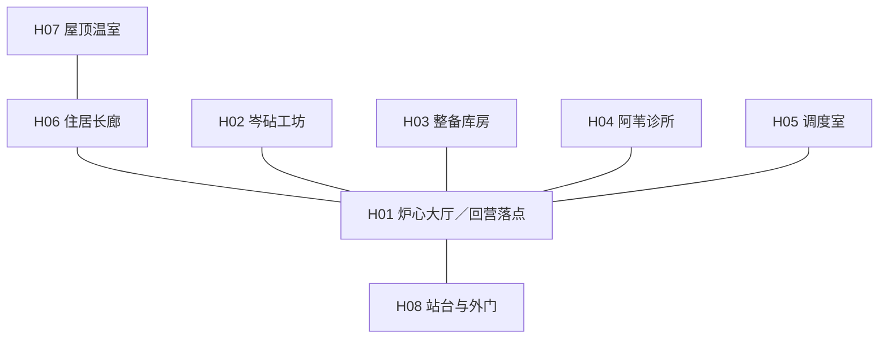
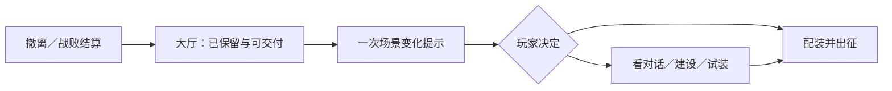

# 余火站：局外场景与回营体验

> 2026-10-12，设计提案，尚未接入游戏。沿用第一章人物、任务与实物撤离规则；下文区分已有功能、场景化扩展与后续设想。布局预览是独立交互稿，不读取游戏存档。

[返回概览](../00_游戏概览.md) · [建设项目与推进](02_基地建设与推进.md) · [打开交互预览](../media/base-preview.html) · [第一章总案](../13_第一章_余火铸造区/01_章节总案.md)

## 1. 核心体验

**余火站是一座由玩家逐步修好的旧车站。每次远征带回的东西，既能组成下一套装备，也能让家中多一处可以使用、有人生活的空间。**

回营提供三个连续的感受：收获终于安全了；上次做的事在这里有了结果；下一趟有一个自己想完成的目标。建设围绕恢复用途、搭建试验条件和安置生活物件展开。炉心最终稳定之前，居民也能点灯、喝水、工作；Q01 的工作灯与 Q07 的稳定供能是两个不同阶段。

采用固定建筑、局部布置的尺度。玩家修复已有房间，在指定位置安装设施、展示收藏、选择灯光与陈设；第一章不需要自由铺地、计算承重或逐格布管。房间之间没有行走耗时，通过场景热点或常驻导航直接切换。

常规回营可在 60～120 秒内完成交付、配装和再次出发。想看新对话、建设或试装时，可主动停留 3～8 分钟。两者都是有效玩法；据点没有时间压力、离线产量或需要逐个收取的建筑收益。

## 2. 空间总图：一张总览，八个功能区

余火站位于废弃高架货运线下。镜头面向车站的开放侧，能同时看见屋顶、二层生活廊与地面工作区。中心炉心和向外延伸的轨道构成识别轮廓，暖光沿玩家修复的线路逐段亮起。

连线表达空间位置与视线关系，不构成必须逐点移动的路线。余火站独立于远征地图，H08 也不是灰区的 A01 入口营地；从站台出发后，才按已解锁出发点进入远征。

| 区域 | 场景主体与人物 | 玩家在这里完成什么 | 修复后最容易被看见的变化 |
| --- | --- | --- | --- |
| H01 炉心大厅 | 低功率炉心、旧钟、投影墙；居民经过 | 查看本次入库、交付任务、查看建设总览、观看回营事件 | 工作灯、炉心运转、投影内容、通往各房间的灯带 |
| H02 岑砧工坊 | 工作台、工具墙、试验隔间；岑砧与维修偶 | 制作、改装、免费基础试用、建设可编程靶台 | 手摇工具变成可用台架，已做过的改装留下样件 |
| H03 整备库房 | 开放式装备架、备用箱、任务物柜 | 换装、比较供牌、选择最多两件备用、明确携带任务物 | 收藏陈列、两具配装人台、当前远征的打包箱 |
| H04 阿苇诊所 | 清洗池、药柜、帘后病床；阿苇 | 查看恢复和补给规则、阅读已见敌人的状态说明 | 接水桶变成清洁流水，灯和洁净台恢复使用 |
| H05 调度室 | 纸地图、机械站牌、收音机；洛舟 | 选择出发点、追踪来源、比较已知路线 | 已修线路从断线变成连通，电台出现已记录的声音 |
| H06 住居长廊 | 衣架、折叠床、公共桌、姓名牌 | 看住户回响、布置公共空间、查看纪念册 | 包裹中的工作服、添出的座位、获救居民留下的生活物件 |
| H07 屋顶温室 | 裂开的采光顶、种植槽、城市远景 | 查看种子成长、布置遮雨棚、安静回看章节记录 | 空槽、菜苗、Q04 后绿植；恢复的是生活景象 |
| H08 站台与外门 | 一段轨道、货车、信号灯、值夜位置 | 查看出征摘要、最终确认出发、查看两地供能结果 | 前进站站牌、返程货箱、守夜机移动灯、最终稳定的外门灯 |

八区是内容归属，不要求制作八张独立全屏背景。首版使用一张总览和工坊、调度室、生活廊三个局部近景；库房与诊所可在总览打开操作层。屋顶和外门随后续章节切片开放近景。

## 3. 每个区域的具体内容

### H01 炉心大厅：把收获变成家中的变化

玩家撤离后先看到本次已入库的东西，再进入大厅。需要交付的任务物在任务卡上显示具体去向，例如“安装封装继电器 → 工作灯恢复”。交付沿用原任务的一次性扣物与奖励，不另加一道收费建设手续。

投影墙放在回营第一眼的视线中。Q01 后显示旧日屋顶；X11 之后允许选择已恢复的片段。查看或跳过演出都记下相同的任务进度。建设总览只突出一个当前追踪项目，并说明缺少物的来源。

回营摘要示例：

> 已入库：清障铲、废钢 ×3。  
> 可以交付：封装继电器。工作灯将恢复，工坊夹具任务将开放。  
> 站里有变化：你救回的维修偶正在门边等候。

### H02 岑砧工坊：让试装备成为一段操作

Q02 交付后，制作和改装按原规则开放。左侧显示底材及完整供牌，右侧预览改装替换的一个牌副本；已购买方案免费切换。桌上只放当前研究的装备，不把所有配方变成悬浮任务标记。

X05 保留免费借用 G26 的教学。拟新增的基础木靶同样免费，可用自有装备试一轮；可选建设 P02 才提供已见敌方意图的重复模拟、固定起手复现与两套结果并排。建设的价值是更细的试验条件，玩家无需先付钱才能理解装备。

S07 完成后，维修偶立即入驻，并保留原有来源提示。P03 只是扩建它的个人维修角：能摆一件已登记装备、收纳玩家命名的组合笔记；不影响它已经获救、已经住下的事实。

### H03 整备库房：下一趟需要带什么

普通装备列表、搜索筛选、牌组预览和比较从一开始可用。穿戴与最多两件备用分别展示；收藏数量不等于携带容量。已存任务物默认留仓，携带夹具等物件时逐项确认，不能一键装包把全部任务物带入风险。

P01 的两具人台可各保存一套装备、已购改装和备用方案。应用时重新验证所有物品、部位解锁与携带限制；缺少的部分高亮，不自动制作、不自动购买、不偷偷替换。人台展示不移出收藏，也不生成第二件实物。

### H04 阿苇诊所：失败后能自然再出发

基本恢复与出发补给始终免费，不受净水修复或建设等级阻挡。Q03 的滤芯让诊所恢复流水与清洁环境，任务奖励仍由原任务发放。这里不出售永久生命，不生产可囤积药水。

战败回营时，阿苇只给一段可跳过的短回应。随后可查看最后一个已公开的敌人意图和未带回物品的原来源；界面不把失败转成居民惩罚、欠款或损坏建筑。

### H05 调度室：把“缺材料”转成“想去哪里”

未建地图长桌时已有完整的已知地图、来源追踪与出发点选择。P04 允许并列保存两条手工路线，各记录一个主要目标、一个可选目标和已知出口，计算固定移动及已知交互成本。

路线旁明确列出未计入的战斗、巡逻中断和未知事件，不承诺“安全路线”或预测随机掉落。地图预览始终只读。S01、Q03、Q05、Q06 对出发点的解锁仍遵循原任务及现场修复条件，建设不能跳过这些条件。

S11 的电台移入调度室；基本重听免费。追踪最多一个主要目标和一个可选机会，未追踪的任务继续保留。下一趟可只拿所需设备就回家，无需完成整张建设清单。

### H06 住居长廊：让被带回来的人有位置

原有四名人物继续承担功能与剧情，不增加招募队伍。S02 名册、S09 包裹、S06 护送分别留下姓名牌、工作服和新住户；生活物件按真实完成的任务出现。

公共长桌建好后，玩家可在三个预设摆位间选择、放一个纪念物、查看已解锁的一段聚餐对话。居民不会因没建桌子而离开或拒绝主线服务。对话是情节内容，不能反复聊天赚好感货币或材料。

伊禾在旧区承担原有职责。完成联络后可在电台听见她；不为了填满基地房间而提前把她搬来。S06 的三名居民在任务实际交付后入驻，不与守夜机支线互相代替。

### H07 屋顶温室：保留一段可以停下来的空间

S11 完成后，菜苗直接出现；若 Q04 已完成，立即使用长成状态，否则在 Q04 后变化一次。P06 增加遮雨棚、长凳及两种布置，不重新索要已经交付的种盒。

这里能看城市灯区、听已获得的广播，查看章末两地供能结果。第一章没有播种、浇水、收菜按钮，植物也不产出战斗补给。种子承载的是生活恢复，重复收菜不会成为出征前的固定步骤。

### H08 站台与外门：让准备收束到一次出发

站牌显示当前起点、主要目标、穿戴牌量、备用和明确携带的任务物。出发按钮在总览与功能操作层都有入口，返回站台不是强制步骤；确认页只汇总会影响本次远征的选择。

守夜机完成 S12 后直接出现；P08 在其原值守位置加设挡风棚和可更换灯罩。Q07 后外门灯从短暂闪动变成稳定照明，两种供能方案都能达到可居住的完整状态，分流结局不会让基地永远显示“低级”外观。

## 4. 五个可见阶段

阶段名称用于概括主线，不是基地经验等级。支线物件独立叠加，例如没救维修偶的完整基地依然没有维修偶。

| 阶段 | 任务依据 | 整体画面与声景 | 最适合给玩家的一件新事 |
| --- | --- | --- | --- |
| 余火未熄 | 初始 | 炉膛暗红、临时提灯、空轨道；风声与不稳的机轮声 | 去拿继电器；不展示八个待建感叹号 |
| 第一盏灯 | Q01 | 工作灯和投影亮起，工坊有人整理桌面 | 看见带回的装置有用途，选择追踪夹具 |
| 有自己的工具 | Q02 | 工坊灯带、装备架与工具声；第一次可选建设 | 改装一次或预览一个项目，均可暂缓 |
| 住得下来的站 | Q03 | 诊所流水、生活廊暖光；植物等按支线叠加 | 在深入铸造区前准备第二套打法 |
| 灯火相连 | Q07 | 炉心稳定、站台完整亮起；远处旧区灯光回应 | 回看自己的建设与人员记录，自由回访 |

Q04～Q06 在“住得下来的站”中持续增加站牌、档案、联络和最终任务准备，不再额外增加三个基地等级。

## 5. 回营流程与事件调度

成功撤离先提交入库结果，再接受交付；战败只显示实际保留的知识与进度，不伪装成成功带回。建设按钮只读取仓库。尚在结算过程的物资不能提前被消费。

每次回营自动突出最多一项场景变化、两段可选短对话。优先级为本次主线交付、人物入驻、建设竣工、其他回响。同次完成多项时合成一条“站里有 3 处变化”，玩家选择逐项看；其他事件留在纪念册，不丢失也不下次强播。

新增局外事件示例：

| 事件 | 触发 | 表现与操作 | 结果 |
| --- | --- | --- | --- |
| 你的工具放哪儿 | Q02 后首次查看建设 | 岑砧移开一块堆料板；预览人台或试验靶，也可暂缓 | 打开项目入口，不免费代建，也不要求二选一永久锁定 |
| 给它一个位置 | S07 已交付，P03 完成 | 维修偶把旧扳手挂到自己的钩子上 | 可选一件收藏供其模仿；来源提示仍免费 |
| 多摆一只杯子 | P05 完成；有名册或护送记录时采用对应文本 | 长桌上添一只杯子，查看一段短对话 | 无奖励重复领取；无居民支线时仍有完整基础版本 |
| 雨留在外面 | S11 已交付，P06 完成 | 雨落在棚顶，植物和长凳进入近景 | 可跳过或停留；不推进剧情时钟 |
| 两处灯都亮着 | Q07 交付 | 站台与远处旧区相继亮灯 | 按供能方案展示联络线或独立炉光，主线结算只有一次 |

所有新增事件使用 `baseEvent.*` 命名，不占用原 X01～X12 编号，不纳入远征的两个额外机会位。

## 6. 建设界面与视觉规格

总览优先展示“房间里有什么变化”。点击建筑进入局部或操作层，建设模式下才显示施工轮廓与项目卡。未开放房间显示清晰用途和前提，例如“净水设备恢复后，这里会接通清洗池”，不显示无法理解的灰色锁链树。

项目卡统一显示：完成后的用途、外观变化、任务条件、仓库现有／所需材料、差额来源、即时完成、可否撤销。比较两项目可以在同一面板完成；取消确认不消耗资源。已完成项目按钮改为“布置”，不继续显示升级红点。

场景沿用雾青工业结构与琥珀暖光。建设前后保留相同镜头与地标，通过灯光、轮廓、人物动作和物件变化形成对照。青绿色表示生活恢复，红色只用于资源不足或操作后果，不把所有未建区域标红。

1280×800 下，总览保留至少 60% 的画面展示基地。详细建设清单以操作层打开，不在全景旁永久堆八张卡片。交互热点至少 44×44，文字标签常驻或可键盘聚焦；Tab、Enter 与 Esc 可完成进入、选择和返回。狭窄窗口以区域列表替代微小热点。关闭面板后把焦点还给原入口。

最小资源清单：一张分层总览、三个局部近景、八组区域热点、五阶段灯光层、八个可选项目的前后差分、维修偶／守夜机两组友好动作、流水／工具／雨棚三组环境音。音效和动画可分批接入，功能提示均有文字版本。

交互预览提供五阶段切换、八区选择、独立支线开关和项目建前／建后对照。它展示空间关系与规则说明，不模拟战斗、材料掉落或真实工程存档，也不是最终美术稿。

## 7. 第一轮体验验证

| 要验证的问题 | 操作与首轮目标 | 未达标时先改什么 |
| --- | --- | --- |
| 玩家知道回营后哪里变了吗 | Q01 回营后不提示地点，观察 5 人中至少 4 人是否注意到工作灯或投影 | 镜头、灯光面积、变化位置 |
| 能否快速再次出发 | 不阅读新增内容的玩家在 2 分钟内完成交付、换装和出发 | 减少面板层级，保留全局出发入口 |
| 八区是否需要背诵 | 让玩家找改装、备用、下一趟起点，最多两次点击抵达各入口 | 名称与热点，不追加导航教学 |
| 建设是否产生主动目标 | Q02 后让玩家自由选择，能说出一个想建项目及原因 | 具体用途、前后变化、材料竞争 |
| 生活内容是否显得像待办 | 询问玩家是否认为不聊天、不种菜会损失奖励 | 去掉奖励暗示与强制提示 |
| 失败后是否愿意重新准备 | 战败返回后能查到丢失目标来源，并保持完整基础服务 | 恢复路径、反馈措辞、出征手续 |

这些是待测目标。当前仓库中的外环截图与验证记录不能作为本提案已经通过的证据。
